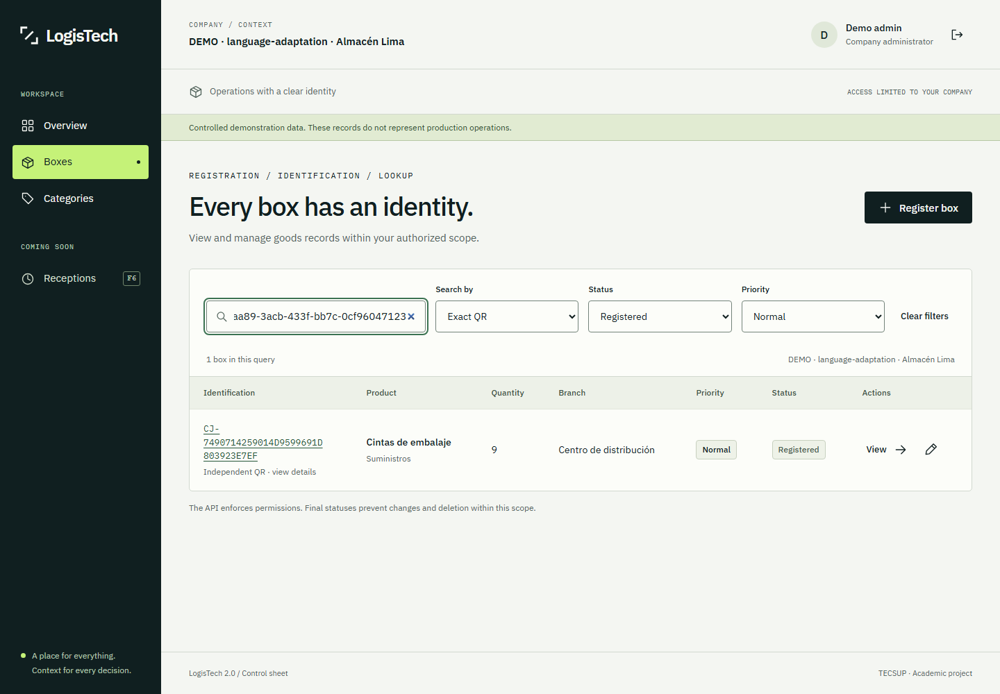
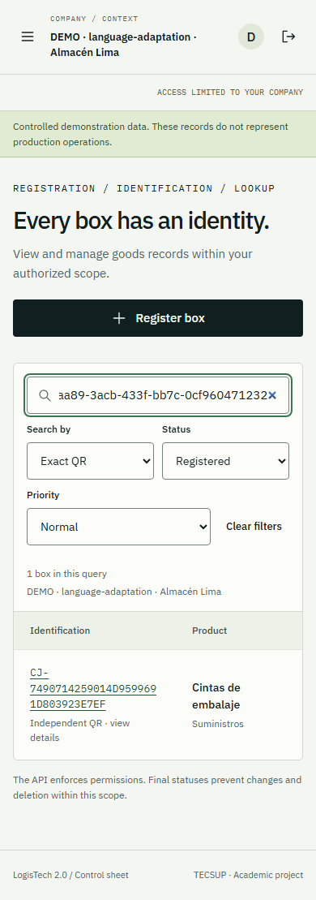
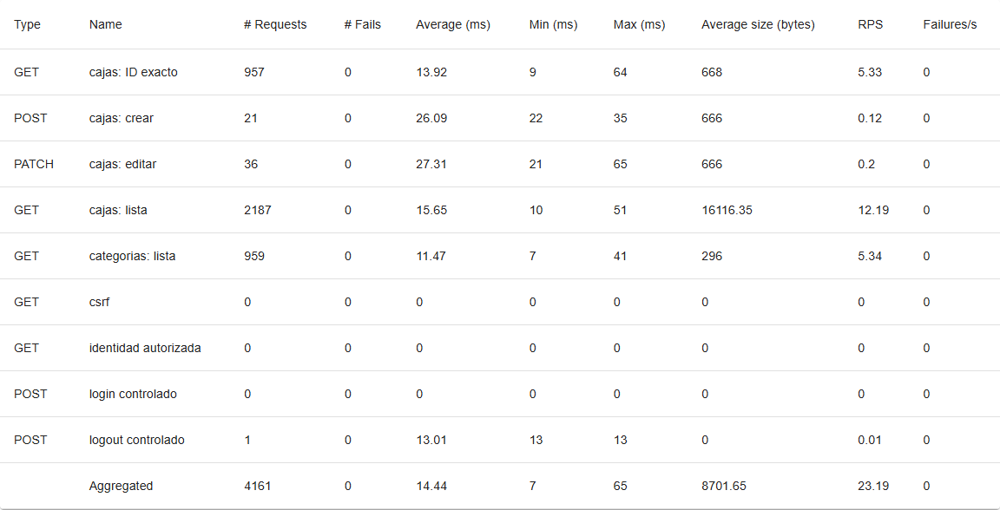
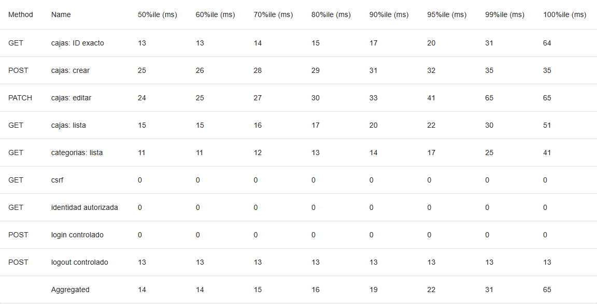
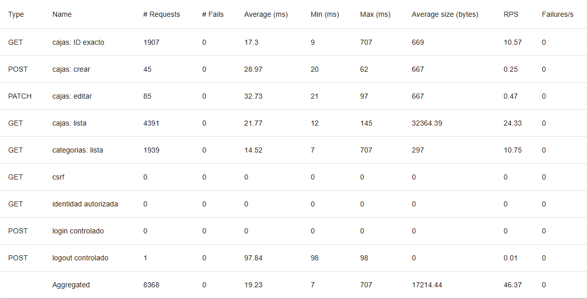
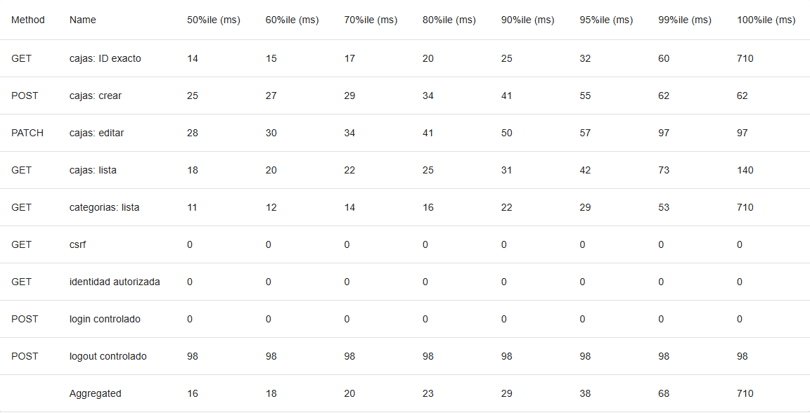

# Anexo de pruebas de LogisTech 2.0

## Anexo A Evidencias de pruebas

### A1 Alcance y criterio probatorio

Este anexo reúne resultados registrados del núcleo inicial y de la adaptación de idioma. No se repitieron pytest, Playwright ni las cargas Locust para preparar la presentación. Las capturas de interfaz ya existían; las nuevas capturas de Locust muestran los reportes HTML originales abiertos localmente, con la red bloqueada. No corresponden a una nueva ejecución de carga. Los extractos de consola se reproducen como texto literal y no se presentan como capturas de terminal.

Se utiliza APA 7 adaptado: tablas y figuras numeradas por separado, número en negrita, título en cursiva, notas de fuente e interpretación y referencias identificables. La maquetación técnica conserva tablas con rejilla tenue para lectura; no se declara cumplimiento de una plantilla institucional que no fue proporcionada. La identificación académica nominal sigue pendiente de confirmación del responsable.

**Tabla 5**

*Herramientas y pruebas con evidencia disponible*

| Herramienta | Objetivo | Resultado acreditado | Fuente |
|---|---|---|---|
| pytest | Validar backend, permisos, integridad y presentación inglesa | 163 aprobadas en 15.66 s | E01 |
| Playwright con Chromium | Verificar flujos web, roles, sesión e idioma | 10 aprobadas; 0 fallidas; 0 omitidas | E02 |
| axe dentro de Playwright | Revisar reglas WCAG A/AA en las vistas ejecutadas | Caso aprobado, sin infracciones detectadas por las reglas usadas | E02 y fuente accessibility.spec.js |
| Locust 2.47.0 | Medir API local con 50 y 100 usuarios | 4 161 y 8 368 solicitudes; 0 fallos HTTP | E03–E09 |
| Node test runner | Completar registro faltante de unitarias frontend | 8 aprobadas; ejecución local nueva de 0.315 s | E19 |
| Grafana k6 | Herramienta prevista en la semana 9 | Sin ejecución; no localizado en el entorno comprobado | E20 |

*Nota.* Las cifras pertenecen a pruebas de distinto alcance; no se suman en un único supuesto porcentaje de cobertura. La medición de carga corresponde a F5 y no acredita rendimiento de cada cambio posterior de idioma.

### A2 Pruebas backend con pytest

**Herramienta y objetivo.** pytest 9.1.1 con pytest-django 4.14.0 sobre Django 5.2.18. Se verifican autenticación y hashing, CSRF, permisos por rol, aislamiento entre dos empresas, campos protegidos, pertenencia de referencias, unicidad, cantidades/estados, códigos HTTP, errores seguros y presentación inglesa.

**Configuración y procedimiento.** La ejecución registrada utilizó Python 3.13.17 en el backend Docker, PostgreSQL real y configuración config.settings.testing. pytest creó su base de prueba a partir de las migraciones existentes y la eliminó al terminar; no utilizó SQLite ni el inventario de trabajo. Proyecto local aislado logistech-language. El comando interior registrado fue:

```text
python -m pytest --ds=config.settings.testing -q
-o cache_dir=/tmp/pytest-language-final
```

*Nota.* Las dos líneas anteriores forman un único comando; el prefijo completo de Docker Compose está conservado en E01.

**Evidencia literal recuperada de E01.**

```text
........................................................................ [ 44%]
........................................................................ [ 88%]
...................                                                      [100%]
163 passed in 15.66s
```

**Resultado e interpretación.** 163 pruebas aprobadas, código de proceso 0. Son 156 pruebas previas y siete pruebas nuevas de idioma/compatibilidad/Admin. El resultado respalda los casos automatizados ejecutados; no implica ausencia absoluta de defectos, cobertura total, auditoría externa o disponibilidad cloud. La primera regresión ampliada, con 162 aprobadas y un fallo de etiquetas OPTIONS, permanece en E10 junto con su explicación de corrección.

### A3 Flujos de navegador con Playwright

**Herramienta y objetivo.** Playwright 1.64.1 con Chromium. Se verifican pantallas públicas, registro/login, cuatro perfiles de acceso, CRUD, filtros, campos inválidos, estados finales, restauración/logout, renovación de sesión y predeterminado inglés incluso con navegador configurado en es-PE.

**Configuración y procedimiento.** Dos workers, cero retries, viewport inicial 1440 × 1000 y servicios de validación en loopback 5174/8001. Datos DEMO de namespace propio y PostgreSQL aislado. Las pruebas responsive usan anchos 320, 390, 768 y 1440. No se guardan trace, vídeo, storageState o credenciales en las evidencias compartidas. La ejecución completa duró 366.32 s; el caso de expiración esperó realmente el vencimiento del access, sin reducir su TTL de cinco minutos.

**Tabla 6**

*Casos recuperados del reporte Playwright*

| Caso | Resultado | Duración s |
|---|---|---|
| accesibilidad automática, ampliación CSS 200%, vacío, 403 y 500 | Aprobado | 7.09 |
| landing, responsive, teclado, movimiento reducido y rutas públicas | Aprobado | 2.60 |
| registro real y validación de confirmación; login incorrecto | Aprobado | 1.05 |
| administrador: CRUD, integridad, filtros, sesión y responsive operacional | Aprobado | 5.76 |
| operador asignado: lectura de categorías y caja autorizada | Aprobado | 1.11 |
| operador pendiente: sin consultas de inventario privado | Aprobado | 0.50 |
| superadmin: ámbito, referencias legibles y menú móvil | Aprobado | 56.51 |
| fallo de red simulado: error de servicio seguro y recuperable | Aprobado | 0.39 |
| English remains the default with Spanish browser preferences | Aprobado | 0.50 |
| access expira realmente a cinco minutos: renovación única y pérdida de refresh | Aprobado | 354.87 |

*Nota.* Fuente E02, diez casos, cero fallos y cero omisiones. Los tiempos de casos paralelos no se suman para obtener la duración total. La prueba de superadmin esperó una ventana de rate limiting; la cuota no fue reducida.

**Evidencia e interpretación.** Las Figuras 5 y 6 son capturas existentes de la ejecución adaptada, no maquetas. Se mantiene Industrial Precision y los datos de negocio españoles, mientras las etiquetas son inglesas. El caso de accesibilidad usa axe con reglas wcag2a, wcag2aa y wcag21aa y exige una lista vacía de infracciones. Esto no constituye certificación WCAG ni reemplaza lector de pantalla, tacto físico o zoom nativo. CSS zoom 200%, foco, teclado y Escape tienen verificación automatizada. Los fallos de red y errores 403/500 interceptados en navegador son simulaciones declaradas; los controles de backend se prueban también contra PostgreSQL real.

**Figura 5**

*Listado de cajas en inglés durante la ejecución Playwright*



*Nota.* Fuente E13, captura de la adaptación a 1440 px. Los nombres españoles de producto, sucursal y empresa son datos DEMO conservados. La imagen no acredita un despliegue cloud.

**Figura 6**

*Consulta de cajas en un viewport móvil de 390 píxeles*



*Nota.* Fuente E14, captura existente con viewport de navegador; no es una prueba en un dispositivo físico. El documento de la prueba verificó ausencia de desbordamiento horizontal general; las tablas pueden tener desplazamiento local.

### A4 Pruebas de carga con Locust

**Herramienta y objetivo.** Locust 2.47.0 y gevent 26.9.0, Python 3.13 aislado en .venv-load. Objetivo: observar latencia y volumen de solicitudes HTTP del inventario autorizado bajo dos cargas locales controladas, no medir logins masivos ni la capacidad máxima del sistema.

**Configuración.** Windows, AMD Ryzen 9 9950X, 16 núcleos/32 hilos; Docker Linux 29.5.3 con aproximadamente 7.33 GiB visibles. Backend Django runserver y PostgreSQL 17.11 privado, generador y servicios en el mismo equipo. Destino exclusivo http://127.0.0.1:8001 de logistech-f5. No se usaron servicios externos, Gunicorn cloud, HTTPS ni bases de producción.

**Tabla 7**

*Configuración efectiva de los escenarios Locust*

| Parámetro | Escenario A | Escenario B |
|---|---|---|
| Usuarios configurados y activos medidos | 50 / 50 | 100 / 100 |
| Incorporación de usuarios | 5 usuarios/s | 10 usuarios/s |
| Calentamiento | 30 s | 30 s |
| Medición efectiva | 179.45 s | 180.44 s |
| Espera entre tareas | Aleatoria de 1–3 s | Aleatoria de 1–3 s |
| Autenticación | 1 login HTTP; demás JWT de fixtures | 1 login HTTP; demás JWT de fixtures |
| Escritura máxima por usuario | 1 POST y 1 PATCH de caja | 1 POST y 1 PATCH de caja |

*Nota.* Fuentes E03 y E04. Todos los usuarios consultaron identidad autorizada y se mantuvieron los permisos, CSRF, cuotas, TTL y aislamiento. No son cincuenta o cien logins simultáneos ni pestañas de navegador.

**Procedimiento registrado.** Humo previo, escenario A y después B, sin otra suite intensa concurrente. Se usaron dos empresas DEMO y cuentas limitadas al namespace. Al segundo 30 se reiniciaron los contadores de medida, no las protecciones de autenticación. Las tareas consultan cajas, categorías e ID exacto y hacen escrituras acotadas. Al finalizar se retiraron las cuentas de carga y se conservaron registros DEMO para auditoría. Este procedimiento se describe para reproducibilidad; no se volvió a ejecutar durante la preparación del informe.

**Tabla 8**

*Resultados finales de carga local con 50 y 100 usuarios*

| Usuarios | Solicitudes | Media ms | p95 ms | Solicitudes/s | Fallos HTTP |
|---|---|---|---|---|---|
| 50 | 4 161 | 14.44 | 22 | 23.19 | 0 / 0.00% |
| 100 | 8 368 | 19.23 | 38 | 46.37 | 0 / 0.00% |

*Nota.* Fuentes E03–E05: eventos finales de cierre y CSV consolidado contrastados. p95 es el percentil 95 de latencia, no una latencia máxima. Las cifras se redondean a dos decimales donde procede; los valores originales conservan precisión completa.

**Interpretación.** En la mezcla y duración ejecutadas, el escenario B procesó aproximadamente el doble de solicitudes por segundo, con mayor latencia media y p95, sin fallos HTTP de capacidad. No se acreditó saturación ni máximo de usuarios. La cercanía entre generador y servicios limita la generalización: estas cifras no predicen latencia de Internet, desempeño en EC2/RDS, experiencia de navegador o producción multiproceso.

Las Figuras 7 a 10 son capturas actuales de los reportes HTML originales, abiertos sin acceso de red. Sus agregados coinciden con los eventos finales. Se omiten aquí las gráficas completas por espacio; el HTML íntegro y su hash están en el paquete de evidencias.

**Figura 7**

*Estadísticas de solicitudes del reporte Locust de 50 usuarios*



*Nota.* Captura del reporte original E06, no de una nueva carga. La fila Aggregated muestra 4 161 solicitudes, 0 fallos, 14.44 ms de media y 23.19 solicitudes/s. Las filas de login/CSRF con contador cero pertenecen a la fase de medición posterior al calentamiento y no significan que se haya desactivado autenticación.

**Figura 8**

*Percentiles del reporte Locust de 50 usuarios*



*Nota.* Captura de E06; la fila Aggregated muestra p95 de 22 ms.

**Figura 9**

*Estadísticas de solicitudes del reporte Locust de 100 usuarios*



*Nota.* Captura de E07; el agregado muestra 8 368 solicitudes, 0 fallos, 19.23 ms de media y 46.37 solicitudes/s.

**Figura 10**

*Percentiles del reporte Locust de 100 usuarios*



*Nota.* Captura de E07; el agregado muestra p95 de 38 ms. Los reportes HTML y datos fuente se conservaron sin sustituirlos por resultados recreados.

### A5 Incidencias y calidad de la evidencia

**Incidencia del exportador.** Al cerrar A y B, Locust en Windows registró ValueError: I/O operation on closed file en su escritor periódico CSV. Los eventos finales y los HTML registran 4 161/8 368 solicitudes y cero fallos HTTP; los snapshots CSV anteriores al cierre tienen 4 143/8 360, diferencias de 18 y ocho solicitudes. No se corrigieron manualmente los originales. El humo posterior del exportador corregido está en E18; sus 17 solicitudes y cero fallos no reemplazan los escenarios A/B.

**Evidencia literal de E08 y E09.**

```text
ValueError: I/O operation on closed file.
```

**Revisión de unitarias frontend.** El comando Docker guardado en E01 terminó con código 0 pero indicó tests 0; frontend/.dockerignore excluye unit. Por ello ese paso no acredita ocho pruebas. Se conservó E01 y se ejecutaron únicamente las ocho unitarias locales con Node 24.19.0, con mocks, sin iniciar servicios ni acceder a la base. E19 registra ocho aprobadas, cero fallos y 315.28 ms. La evidencia válida histórica de F5 contiene cinco unitarias; no se presenta como ocho de la adaptación.

**Tabla 9**

*Diferencias e incidencias preservadas en los registros*

| Registro | Observación real | Tratamiento documental |
|---|---|---|
| Regresión ampliada inicial | 162 aprobadas y 1 fallida en OPTIONS | Se conserva E10; regresión corregida de 163 en E01 |
| CSV periódico Locust A/B | 4 143 / 8 360 solicitudes | Snapshot, no total definitivo |
| Eventos finales y HTML A/B | 4 161 / 8 368, 0 fallos HTTP | Base de la Tabla 8 |
| Escritor CSV | Excepción al cierre | Se conserva consola; no se denomina generador libre de incidentes |
| Unitarias dentro de contenedor | Código 0, pero 0 pruebas | No se cuenta como aprobación de ocho |
| Recuperación de unitarias local | 8 aprobadas con mocks | Única suite nueva de esta preparación; E19 |

*Nota.* No hubo nuevas ejecuciones pytest, Playwright, Locust o k6 durante esta preparación documental. Una salida de proceso 0 no prueba por sí sola que se hayan descubierto y ejecutado casos.

### A6 Grafana k6 previsto y herramienta utilizada

Grafana k6 fue mencionado como herramienta prevista en la exposición de la semana 9, según el antecedente proporcionado por el responsable. La herramienta utilizada en las cargas documentadas fue Locust, acreditada por sus reportes originales. No se atribuyen a k6 las cifras de la Tabla 8.

La comprobación local E20 no encontró k6 en PATH, en las rutas estándar inspeccionadas o en las imágenes Docker locales. Los entornos LogisTech estaban detenidos. Para respetar la prioridad documental y la prohibición de modificar infraestructura, no se instaló k6, no se descargó una imagen, no se iniciaron servicios y no se ejecutó una carga adicional. No existen resultados o capturas de ejecución k6 en esta entrega. Esta comprobación no demuestra que el binario sea inexistente en cualquier otra ubicación no inspeccionada.

### A7 Trazabilidad de fuentes

**Tabla 10**

*Registro de fuentes primarias del anexo*

| ID | Archivo o conjunto | Qué acredita |
|---|---|---|
| E01 | adaptacion-verificacion.json | pytest 163, checks y límite del paso Node Docker |
| E02 | adaptacion-e2e.json | Diez casos Playwright y sus duraciones |
| E03–E04 | a-50 / b-100 _summary.json | Eventos finales de carga |
| E05 | resumen-escenarios.csv | Consolidado contrastado de métricas |
| E06–E07 | a-50 / b-100 .html | Reportes originales y capturas de estadísticas |
| E08–E09 | a-50 / b-100 _console.txt | Cierre y excepción del escritor CSV |
| E10–E11 | Regresiones iniciales conservadas | Fallos reales previos, separados de los finales |
| E12 | fase5-verificacion.json | Evidencia histórica de cinco unitarias frontend |
| E13–E15 | Capturas adaptacion-cajas | Interfaz, responsive y ampliación CSS |
| E16–E17 | a-50 / b-100 _stats.csv | Snapshots anteriores al cierre |
| E18 | smoke _stats_final.json.json | Humo del exportador corregido |
| E19 | unitarias-frontend-recuperacion.json | Ocho unitarias locales y versión Node |
| E20 | k6-disponibilidad.json | Comprobación sin carga k6 |

*Nota.* Rutas completas, tamaño y SHA-256 íntegro de cada fuente se incluyen en evidencias/presentacion/manifest-evidencias.json. El hash permite comprobar integridad, pero no equivale a certificación independiente del experimento. El paquete compartido no contiene .env, credenciales DEMO, tokens, bases o volúmenes.
