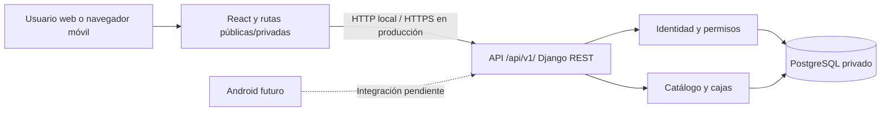

# Arquitectura vigente — LogisTech 2.0

## F6, Bloque 2 — recepción y trazabilidad

boxes.reception concentra recepción atómica: actor/caja/empresa/referencias bloqueados; Receipt único por caja y por actor/empresa/idempotency-key; estado y BoxEvent confirmados juntos. BoxViewSet instrumenta creación/edición/borrado y deriva transiciones finales anteriores al mismo servicio. Eventos inmutables con snapshot UUID de caja, que sobrevive a borrado REGISTERED. PostgreSQL bloquea UPDATE/DELETE de historia mediante triggers; no se afirma resistencia frente al propietario de DB/TRUNCATE.

boxes.identification genera SVG determinista en memoria con qrcode 8.2, sin almacenamiento externo ni API de QR. Resolver usa queryset defensivo y ámbito de servidor. Etiqueta SVG vectorial 100×80 mm con referencia legible. Frontend muestra Blob local y descarga autenticada; cámara BarcodeDetector solo por acción del usuario y soporte/contexto seguro, con entrada manual siempre disponible. El stream se libera al detener/desmontar. Nuevo código no abre enlaces arbitrarios leídos del QR.

React incorpora Identification, Receptions e History y contadores de recepciones/eventos; usa contratos REST compartibles con Android. Los detalles históricos se presentan como datos de negocio, no como panel técnico JSON. Continúan monolito modular, PostgreSQL, Industrial Precision y catálogos ingleses. Ver REGLAS_RECEPCION.md y ANDROID_COMPATIBILIDAD.md.

Estado actualizado el 2026-10-28: F6 bloque 1 añade administración operativa al núcleo
F0–F5 y su adaptación inglesa. El monolito modular y PostgreSQL compartido se
conservan. Ver [PLAN_FASE_6](PLAN_FASE_6.md) e [INFORME_FASE_6](INFORME_FASE_6.md).
La carga Locust 50/100 pertenece a F5; no mide automáticamente las APIs nuevas.
Cloud continúa parcial, sin despliegue; F7/F8 no iniciadas.

Presentación vigente: inglés predeterminado, catálogos locales, sin API externa de
traducción. Los contratos anteriores conservan rutas, campos y enums. F6 añade
endpoints y `User.branch` opcional mediante migración aditiva, sin reescribir las
migraciones anteriores. Los ADR finales conservan contexto de propuesta inicial;
decisiones vigentes en DECISIONES_TECNICAS y el apartado F6 siguiente.

## Administración operativa F6

`organizations/views.py` administra Company y Branch; `catalog/views.py` reutiliza
Category y añade Product; `accounts/operations.py` administra cuentas con su política
propia. Se reutilizan TenantViewSet, permisos actuales, campos estrictos, throttles,
errores seguros y transacciones. Se relee el actor bajo bloqueo antes de escribir;
se bloquean empresa y referencias al persistir. El cliente no impone permisos Django.

`User.branch` es una asignación organizativa única opcional con PROTECT. No impone
un filtro nuevo por sucursal a las cajas: el alcance continúa siendo la empresa.
Solo el superadmin mueve cuentas entre empresas; la sucursal debe ser coherente y
el creador histórico de una caja permanece. SUPERADMIN y cambios sobre la propia
cuenta quedan fuera de la API de administración operativa; su mantenimiento usa
el procedimiento restringido existente. No hay DELETE de cuentas ni reset de contraseña
por esta API, que necesitaría revocación de sesiones y un flujo separado.

`/overview/` obtiene recuentos SQL reales según rol y empresa. React reutiliza los
componentes de formulario, tabla, modal y errores; `Administration.jsx` agrega cuatro
vistas con navegación y acciones por rol. El servidor aplica la autorización final.
El cambio de contexto remonta el contenido y descarta formularios de otro ámbito.

## Componentes y límites

Monolito modular Django + DRF, React/Vite con JavaScript, Tailwind, React Router y Fetch, PostgreSQL y Docker Compose. Frontend y API son procesos separados; PostgreSQL solo accesible en la red interna de Compose. Publicar servicios de desarrollo únicamente en loopback. En producción, servir el frontend compilado y la API con HTTPS mediante el servicio o proxy autorizado; no usar Vite dev server ni Django runserver como despliegue.



El núcleo del 25 % tiene registro, login, identidad actual, categorías, cajas y un dashboard limitado a datos reales autorizados. Recepciones, QR con cámara, movimientos, reportes y estadísticas avanzadas permanecen para F6. La vista «módulo en desarrollo» es informativa, sin botones que aparenten ejecutar esas operaciones.

## Estructura implementada

Se usa la raíz actual como raíz del proyecto para evitar una carpeta duplicada `logistech-v2/`. F1 creó infraestructura, F2 los modelos y F3 serializers/vistas CRUD en catalog/boxes y utilidades de autorización en core/api.py. F5 creó `load/` para Locust. La adaptación posterior agrega catálogos/etiquetas ingleses sin alterar módulos de negocio.

```text
backend/
  config/settings/{base,development,production}.py
  apps/{core,accounts,organizations,catalog,boxes}/
  tests/
  manage.py
  requirements.txt
  requirements-dev.txt
  Dockerfile
frontend/
  src/{components,pages,services,hooks,styles,i18n}/
  package.json
  package-lock.json
  Dockerfile
docs/
load/
docker-compose.yml
.env.example
.gitignore
README.md
```

`core`: salud y respuestas comunes; `accounts`: usuario y autenticación; `organizations`: empresa y sucursal; `catalog`: categorías y productos mínimos; `boxes`: cajas. Se crearán módulos cuando tengan responsabilidad real. Sin Kubernetes, microservicios, colas, TypeScript, Vitest ni herramienta extra de documentación API.

## Datos: núcleo normalizado implementado

F2 implementó User, Company, Branch, Category, Product y Box. Branch y Product son referencias mínimas necesarias para que la caja tenga producto, categoría y pertenencia coherentes; no implican construir su CRUD público en el 25 %. Se administrarán con Django Admin o comando de demostración autorizado. Pedidos, recepciones, movimientos y auditoría persistente completa son diseño futuro.

| Entidad | Decisiones implementadas |
|---|---|
| User | UUID, email normalizado único, password de Django, role, company nullable, activo y fechas. Email case-insensitive mediante normalización y restricción de base de datos |
| Company | UUID, nombre, estado y fechas; sin borrado en cascada del historial |
| Branch | Empresa obligatoria, nombre único por empresa, dirección y estado |
| Category | Añadir company obligatoria; nombre único por empresa; descripción, fragilidad y perecibilidad como flags independientes |
| Product | Empresa, categoría de esa misma empresa, SKU único por empresa, nombre y estado |
| Box | UUID PK, internal_id único generado por servidor, qr_code único independiente y no secreto, producto, empresa, sucursal, cantidad positiva, peso decimal positivo opcional, prioridad, estado, creador y fecha |

Identificador alternativo propuesto: `CJ-` seguido de UUID v4 completo sin guiones; legible en etiqueta y entrada manual, aunque más largo que cuatro cifras. Generar con aleatoriedad segura, imponer UNIQUE y reintentar de forma acotada ante colisión. QR usa otro UUID aleatorio; no derivarlo del identificador ni usarlo como autorización. La unicidad real depende de la restricción, no de la probabilidad. El reemplazo de QR dañado se diseñará en F6.

### Correcciones al modelo inicial

- Fragilidad y perecibilidad pueden coexistir. Un tipo físico de caja no equivale a una categoría de producto. Proveedor y ubicación física quedan diferidos hasta corroborar su necesidad.
- `Box.company` duplica información derivable del producto/sucursal. Se conserva para consultas y aislamiento, exigiendo coincidencia en cada escritura. Las FKs simples no garantizan esa igualdad entre tablas: usar un servicio transaccional y validación también en Admin; las restricciones compuestas o triggers se evaluarán si aparecen otras vías de escritura.
- Prohibir cambiar de empresa productos/categorías/sucursales ya referenciados. Usar PROTECT en relaciones del negocio y desactivar recursos en lugar de borrar historial. DELETE de una categoría referenciada devuelve conflicto documentado; cajas sin historia podrán borrarse en el CRUD inicial, revisando la política cuando existan recepciones.
- Índices propuestos: `(company_id, status, created_at)` para cajas, UNIQUE de identificadores y de `(company_id, sku)`, más índices de FK. Evaluar planes reales antes de añadir otros.
- FKs requeridas NOT NULL; cantidad > 0 y peso > 0 cuando exista mediante CHECK; timestamps con zona horaria, almacenamiento UTC y visualización America/Lima.
- Una caja representa un producto en el 25 %. Cajas mixtas requerirían BoxItem y quedan fuera de alcance.
- Order y OrderItem futuros tendrán cantidades positivas; Reception necesita evento de verificación e idempotencia para evitar recepciones duplicadas. Movimientos requieren dirección/tipo explícito y transacciones para evitar doble contabilización. No calcular stock solamente contando cajas.
- AuditLog futuro conservará actor histórico aun si se desactiva/elimina la cuenta; no almacenará tokens ni contraseñas. Sucursal destino y caja deben pertenecer a la misma empresa; transferencias entre sucursales serán operaciones explícitas.

El diagrama editable [MODELO_DATOS.mmd](MODELO_DATOS.mmd) representa el núcleo real migrado en F2; omite tablas de framework, detalladas en BASE_DE_DATOS.md. [MODELO_FUTURO.mmd](MODELO_FUTURO.mmd) separa las ampliaciones no implementadas de F6.

## Política de acceso implementada

Todo permiso se decide en el backend y consulta la cuenta activa en base de datos. Los claims JWT no sustituyen la pertenencia vigente. Empresa inactiva deniega operaciones. Las listas devuelven solo recursos de la empresa autorizada; un detalle de otra empresa devuelve 404 para no revelar existencia. Usuario autenticado sin empresa obtiene 403 en recursos privados, no un inventario global.

| Recurso/acción | Superadmin | Admin empresa | Operador asignado | Operador sin empresa | Prueba prevista |
|---|---|---|---|---|---|
| Registro público | Crea solo operador sin empresa, independientemente del solicitante | Igual | Igual | Igual | registro y rechazo de campos privilegiados |
| Identidad propia | Sí | Sí | Sí | Sí | identidad/autenticación |
| Categorías: leer | Todas | Su empresa | Su empresa | No | listas/detalles entre empresas |
| Categorías: crear/editar/borrar | Sí, empresa explícita | Su empresa | No | No | escritura por rol y referencia protegida |
| Cajas: leer/crear/editar | Sí | Su empresa | Su empresa; creador impuesto por servidor | No | CRUD y manipulación de company/created_by |
| Cajas: borrar | Sí | Su empresa | No | No | DELETE por rol |
| Asignar empresa/rol | Procedimiento administrativo explícito | Diferido | No | No | rechazo en registro y actualizaciones |
| Empresas/productos/sucursales mínimos | Administración restringida | Sin CRUD público inicial | No | No | Admin y fixtures controlados |

En el 25 %, el operador asignado trabaja en las sucursales de su empresa. Las asignaciones específicas por sucursal se diseñarán en F6 antes de afirmar control granular. La escritura de categorías por operador se deniega deliberadamente. Los porcentajes académicos no constituyen permisos.

`createsuperuser` debe generar role=SUPERADMIN y flags is_staff/is_superuser coherentes. is_staff por sí solo no otorga acceso global de negocio; rechazar combinaciones incoherentes en gestores y formularios administrativos. No exponer edición pública de rol/empresa/flags.

## Contrato y antecedentes de seguridad

Rutas propuestas: `/api/v1/health/`, `/auth/register/`, `/auth/login/`, `/auth/refresh/`, `/auth/me/`, `/categories/`, `/categories/{uuid}/`, `/boxes/`, `/boxes/{uuid}/` bajo el mismo prefijo. En F3 documentar cuerpos, filtros, autenticación, ejemplos y cada respuesta. Health no expone configuración y devuelve 503 si su comprobación de base de datos falla.

Registro 201; lectura/login 200; DELETE correcto 204; validación 400; token ausente/inválido/expirado 401; permiso 403; inexistencia 404; conflicto de integridad de negocio 409 cuando proceda; límite 429 con Retry-After; error inesperado 500 sin traceback. La API conserva claves legadas españolas y estructura consistente; los mensajes humanos predeterminados están en inglés; React muestra pantallas apropiadas sin convertir fallos en respuestas 200 de API.

JWT propuesto: access de 5 minutos en memoria del navegador; refresh de 1 día en cookie HttpOnly, SameSite y Secure en producción, restringida a renovación. Proteger renovación/logout contra CSRF y validar origen; frontend y API preferentemente en el mismo sitio. Android podrá requerir un flujo refresh distinto autenticado, pendiente. Cerrar sesión borra cookie y memoria; revocación/rotación se verificará con la biblioteca elegida. No persistir tokens en localStorage ni incluir secretos en variables VITE_.

Rate limiting inicial propuesto: login 5/min/IP y 10/15 min por identidad normalizada; registro 3/h/IP; refresh 30/h por cuenta; API privada 120/min por usuario. Son valores de diseño, no límites implementados. Evitar revelar si un email existe, no confiar en X-Forwarded-For sin proxy conocido. Probar límites y expiración con caché limpia. DRF permite limitación local, pero sus contadores no atómicos no garantizan un umbral exacto bajo concurrencia; antes de producción multiproceso se requiere una estrategia compartida y atómica evaluada en F7. No añadir Redis inicialmente por apariencia.

F1 aplicó configuración/red; F2 autenticación; F3 permisos, filtros, validaciones y transacciones CRUD. SEGURIDAD.md precisa límites: caché por proceso, 120/min por usuario en CRUD, refresh 30/h por IP y access válido hasta 5 minutos tras logout. Los valores de diseño anteriores son antecedentes; el contrato efectivo está en ENDPOINTS.md. F3 conserva marcas de estado iniciales sin implementar Reception ni flujos F6.

## Antecedente ADR-001: monolito modular y base compartida con aislamiento por empresa

Estado: propuesto. Fecha: 2026-10-26. Decisor: usuario mediante aprobación de la fase siguiente.

Contexto: proyecto académico demostrable, equipo y presupuesto no especificados, tres roles y evolución Android/cloud.

| Opción | Complejidad | Costo operativo | Escalabilidad | Familiaridad del equipo |
|---|---|---|---|---|
| Django modular, una PostgreSQL | Baja/moderada | Menor cantidad de servicios | Escala vertical y posteriormente por procesos | Por confirmar; stack solicitado |
| Microservicios o base por empresa | Alta | Mayor operación y coordinación | Más aislamiento físico, mayor complejidad transaccional | Por confirmar |

Decisión propuesta: primera opción; prioriza transacciones y pruebas de permisos. Consecuencia: cada consulta y escritura debe imponer el tenant; no hay aislamiento físico entre empresas. Revisar si el volumen o las obligaciones reales lo requieren, sin prometer capacidad no medida.

## Antecedente ADR-002: versiones aisladas y usuario propio antes de migrar autenticación

Estado: propuesto. Las instalaciones globales no definen las versiones del proyecto. Seleccionar una combinación mantenida de Python/Django/DRF/JWT/psycopg y PostgreSQL en F1 con dependencias fijadas; Node/npm y lockfile equivalentes para frontend. La documentación JWT consultada no acredita la combinación local actual.

F1 arrancará configuración/health y verificará conectividad y mecanismo de migraciones sin aplicar migraciones de auth/admin con el User estándar. F2 habilitará accounts y creará User en su `0001_initial` antes de migrar auth/admin. Así se respeta la fase de modelos sin un usuario desechable. Ver [Django](https://docs.djangoproject.com/en/5.2/topics/auth/customizing/).

## CHECKLIST HUMANO

- Revisar las políticas propuestas: categorías privadas, operador con escritura limitada de cajas y caja de un solo producto.
- Autorizar recursos y dominio/HTTPS antes de un despliegue externo futuro. Ningún recurso remoto se creó.
