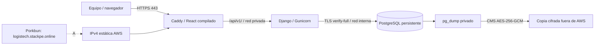

# Guía de implementación AWS — F7

Preparación local del 28/10/2026. **No ejecutar los pasos de creación, instalación
remota ni DNS hasta aprobar el presupuesto y el despliegue.** Consultar
[presupuesto](PRESUPUESTO_AWS_F7.md), [DNS/TLS](DNS_TLS_F7.md),
[seguridad](CHECKLIST_SEGURIDAD_F7.md) y [recuperación](BACKUP_RECUPERACION_F7.md).

## Arquitectura propuesta



Una Lightsail Ubuntu 24.04, Linux IPv4, 4 GB RAM/2 vCPU/80 GB SSD, Ohio, precio
publicado US$24/mes, más una IP estática asociada incluida. Confirmar disponibilidad
real y aplicación de créditos en la cuenta Free Plan antes de crear. EC2 se conserva
como alternativa documentada, sin crear ambas arquitecturas. No se añaden RDS,
balanceador, Route 53 ni servicios administrados por defecto.

## 1. Revisar y autorizar

Confirmar identidad de cuenta en Console sin compartir claves, us-east-2, saldo y
vencimiento. Verificar bundle/blueprint Ubuntu realmente disponibles y elegibilidad;
si AWS solicita Paid Plan, detenerse. Definir clave SSH regional y el IPv4 `/32`
del administrador, contacto ACME real y aceptación de hallazgos residuales del
escaneo. Revisar costos de snapshots si se desean; no están activados inicialmente.

Las plantillas `deploy/aws/lightsail.yaml` y `ec2.yaml` pasaron validación local
con cfn-lint; eso no valida cuotas, existencia de IDs o permisos de esta cuenta.
Lightsail exige bundle y blueprint explícitos para no inventarlos. Si CloudFormation
no está habilitado en la cuenta, no cambiar el plan: revisar la creación equivalente
en Console con la misma autorización. La plantilla crea solo VM/IP, no instala
software ni toca DNS. `Retain` protege frente a eliminación accidental; los recursos
retenidos siguen costando. SSH solo 22/TCP `/32`, web 80/443/TCP. Sin 5432/8000/5173
públicos. Las plantillas no contienen credenciales ni roles con privilegios amplios.

## 2. Preparar el host tras aprobación

Asociar IP estática y comprobar firewall. Verificar la huella SSH desde Console
antes del primer acceso; no desactivar HostKeyChecking. Instalar desde una copia
revisada de `deploy/production/bootstrap-ubuntu.sh` en Ubuntu 24.04. El script
instala Docker Engine/Compose del repositorio oficial, Git, curl, Python y OpenSSL.
No fue ejecutado contra una VM AWS en esta preparación. Aplicar parches del host,
usar autenticación por clave, bloquear login SSH con contraseña/root según la
política del equipo y comprobar acceso antes de cerrar la sesión vigente.

Usar un usuario de despliegue dedicado. Pertenecer al grupo Docker equivale a
privilegio root; no otorgarlo a usuarios de la aplicación. No abrir Docker TCP.
Clonar el repositorio y seleccionar el **SHA completo revisado de F7**, conservando
`main` estable. Si F7 todavía es local, primero requiere revisión/publicación
del código; no se presupone que el remoto ya lo contiene.

## 3. Configuración y secretos

Copiar `deploy/production.env.example` a `.env.f7` (ignorado), reemplazar `SOURCE_REF`
por SHA completo y `ACME_EMAIL` por correo real. Mantener:

```dotenv
PUBLIC_DOMAIN=logistech.stackpe.online
PUBLIC_ORIGIN=https://logistech.stackpe.online
POSTGRES_DB=logistech
```

Generar secretos **nuevos para cloud** en el equipo del operador mediante la imagen
`deploy/production/provision.Dockerfile` y `provision-secrets.sh`. El generador se
niega a sobrescribir archivos. Directorio 700 y archivos privados 600; Django UID
10001 necesita leer sus montajes. Windows requiere ACL restrictiva equivalente y
permiso explícito en cada archivo para que Docker Desktop pueda leerlo: no dar
acceso Everyone para resolver un problema de ACL.

Transferir por SSH/SFTP únicamente `django_secret_key`, `db_owner_password`,
`db_app_password`, `postgresql.key`, `postgresql.crt` y `postgresql-ca.pem` al
directorio privado indicado por `F7_SECRETS_DIR`. **No transferir**
`postgresql-ca.key` ni la clave privada de recuperación de backups. Mantener esas
claves offline en un almacén protegido con copia independiente. Compose secrets
son archivos montados, no un gestor cifrado de secretos; su seguridad depende del
host y sus permisos. No guardar claves AWS/Porkbun en el servidor ni en Git.

## 4. Primera instalación controlada

Solo en el host autorizado y con checkout limpio del SHA aprobado:

```bash
bash deploy/production/preflight.sh
docker compose -p logistech-production --env-file .env.f7 -f compose.production.yml build db backend proxy
docker compose -p logistech-production --env-file .env.f7 -f compose.production.yml up -d --wait db
docker compose -p logistech-production --env-file .env.f7 -f compose.production.yml --profile tools run --rm -T migration
docker compose -p logistech-production --env-file .env.f7 -f compose.production.yml up -d --wait backend proxy
```

Las compilaciones Go/React consumen CPU/RAM y tiempo; preferir construir en el
equipo/CI y transferir las imágenes verificadas con `docker save`/`load` para una
VM pequeña. Sin necesidad de contratar ECR. Registrar hashes de las imágenes y
el SHA fuente; no asumir reproducibilidad binaria total de repositorios de paquetes
que reciben actualizaciones. Las migraciones se ejecutan una vez con rol propietario;
Gunicorn usa otro rol sin superusuario ni permisos DDL.

Crear el administrador real mediante `createsuperuser` interactivo en el contenedor
migration; nunca mediante argumentos que expongan contraseñas ni fixtures DEMO.
No ejecutar `create_demo` en cloud. La migración nueva de F7 solo agrega contadores
de rate limiting; no sustituye el usuario personalizado ni rehace F0–F6.

## 5. DNS, TLS y aceptación pública

Aplicar el registro A aprobado siguiendo [DNS_TLS_F7](DNS_TLS_F7.md). Verificar
resolución antes de insistir con ACME para evitar límites de emisión. Caddy sirve
el frontend y la API del mismo origen, obtiene TLS público y lo renueva conservando
sus volúmenes. `health.sh` valida HTTPS **sin** `-k`. Verificar desde otra red:
login/logout/refresh, roles, aislamientos entre dos empresas, CRUD, QR/etiqueta,
recepción/historial y cámara compatible. Usar cuentas de pruebas controladas,
separadas de datos operativos, sin carga intensiva sobre el servidor público.

Revisar `/api/v1/health/`, rutas profundas React y errores JSON. Confirmar con
inspección de puertos que DB y Gunicorn no están publicados. Probar un backup y
restauración en DB nueva antes de entregar acceso al equipo. Hasta completar esto,
el requisito cloud sigue parcial y no existe URL pública validada.

## 6. Operación y actualización

`bash deploy/production/update.sh FULL_SHA` exige checkout limpio del SHA, valida
configuración, hace backup y luego compila/migra/actualiza. Primero revisar el plan
de migración y compatibilidad; un rollback de código no revierte el esquema.
Conservar imagen anterior y dump, sin borrar volúmenes. Programar backup/cifrado/
descarga y comprobar edad de la última copia; los scripts no crean por sí solos
un cron ni copias externas automáticas. Programar `cleanup_throttles` diario para
eliminar solo contadores expirados, sin resetear límites activos ni datos de negocio.

Logs: `docker compose ... logs --since 1h backend proxy db`, sin copiar datos
privados a tickets. Gunicorn registra método/estado/duración, sin query/URI/tokens;
Caddy conserva errores de ejecución. Rotación Docker 3×10 MB por servicio. Revisar
salud, espacio, RAM, CPU y métricas incluidas de Lightsail, respaldos, certificado
y créditos; no se contrató monitoreo adicional. Definir responsables, alertas y
RPO/RTO reales tras medir restauración en AWS; no afirmar SLA ni alta disponibilidad.

Mantener `F7_REHEARSAL=true` solo localmente. Los scripts fijan nombres de proyecto
distintos para producción y ensayo, evitando elegir una pila equivocada. No usar
`down -v`, `docker volume prune`, `reset --hard` ni borrados automáticos de datos.
