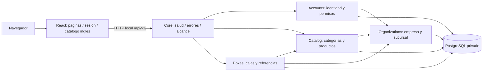
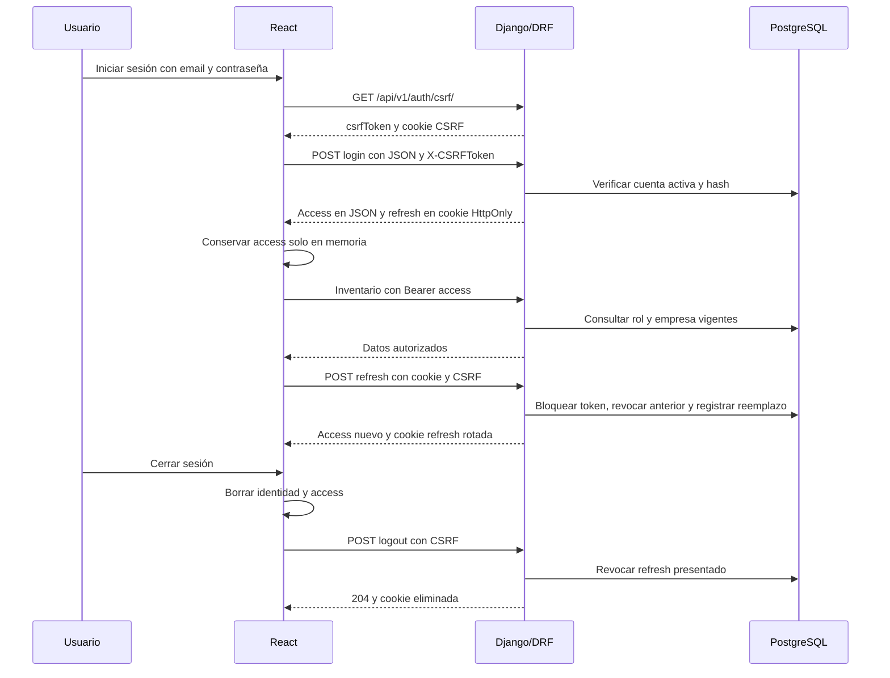
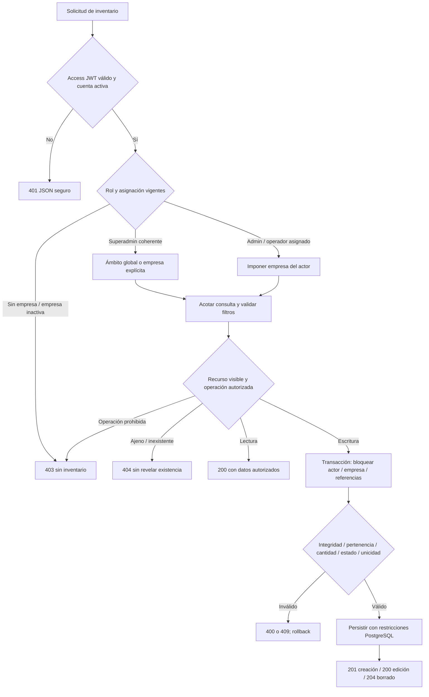

# LogisTech 2.0 — Informe académico del núcleo inicial

Fecha: 27 de octubre de 2026, America/Lima. Versión documental: adaptación de idioma posterior a F5. Proyecto académico de Desarrollo de Soluciones en la Nube — TECSUP.

**Estado:** núcleo F0–F5 validado localmente; adaptación de idioma y consolidación documental en esta entrega. Requisito cloud **PARCIAL**, sin aplicación desplegada externamente. F6/F7/F8 no iniciadas. La publicación del código en GitHub no representa un despliegue del sistema.

## 1. Definición del proyecto y objetivos

### 1.1 Problema y propuesta

LogisTech 2.0 organiza la identificación y consulta de mercancía por empresa. La información de producto, categoría, cantidad, sucursal, prioridad e identificación necesita permanecer vinculada y accesible solo a las personas autorizadas. El núcleo implementado proporciona categorías y cajas, un identificador interno automático independiente del QR y un espacio de consulta operativo. No se presenta como sistema completo de gestión de almacenes ni como contabilidad de stock.

La aplicación web conserva la dirección visual Industrial Precision: alternativa A como composición principal con recursos oscuros de marca inspirados en B. React se conecta a una API Django/DRF y PostgreSQL real. El programa se presenta en inglés por defecto y la documentación permanece en español.

### 1.2 Objetivo general

Construir y validar un núcleo web multiempresa para registrar, clasificar y consultar cajas mediante autenticación y permisos en servidor, con integridad de datos, documentación reproducible y límites explícitos.

### 1.3 Objetivos específicos verificables

- Ofrecer registro y login separados; registro público de operador sin asignación de empresa o privilegios.
- Implementar CRUD de categorías y cajas, referencias legibles y búsquedas/filtros autorizados.
- Aislar consultas/escrituras por empresa y rechazar enlaces a recursos ajenos.
- Generar internal_id en servidor y mantener QR independiente, ambos únicos sin usarlos como autorización.
- Validar PostgreSQL, migraciones, seguridad, interfaz responsive, accesibilidad automática y rendimiento local con evidencia.
- Proporcionar instalación reproducible y documentación de arquitectura, datos, procesos y mantenimiento.
- Centralizar los textos de aplicación en inglés sin modificar contratos o datos introducidos por usuarios.

### 1.4 Usuarios y audiencia

SUPERADMIN administra el ámbito global conforme a flags coherentes; COMPANY_ADMIN trabaja en su empresa; OPERATOR asignado lee categorías y opera cajas autorizadas sin eliminarlas; operador sin empresa no accede a inventarios privados. El usuario operativo debe conocer su trabajo de almacén, sin necesidad de manipular UUID o configurar Django. El informe se dirige también al profesor y a quienes mantengan el sistema; la instalación presupone manejo básico de Git, terminal, variables de entorno y Docker.

### 1.5 Autoría y antecedentes

El repositorio de esta implementación es `anthonyarana-debug/logistech-2.0`, actualmente público, según consulta directa a GitHub durante la adaptación. La titularidad de una cuenta GitHub no acredita por sí sola integrantes o contribuciones académicas: esta documentación no inventa una nómina ni reparte porcentajes de autoría. El responsable debe completar la identificación académica exigida por su institución antes de presentar el informe.

Existe como antecedente un proyecto Android separado. No se modificó ni sobrescribió. No se realizó una auditoría de sus fuentes Android para acreditar reutilización o retrocompatibilidad; esta versión define su API propia y no garantiza compatibilidad con contratos Android no verificados. El nombre 2.0 expresa la evolución del proyecto, no una certificación de integración entre ambas aplicaciones.

## 2. Especificación de requisitos y alcance

### 2.1 Requisitos generales y funcionales

| ID | Requisito | Implementación / evidencia |
|---|---|---|
| RF-01 | Registro e inicio de sesión separados | accounts, formularios públicos, pruebas auth/E2E |
| RF-02 | Identidad vigente y sesiones renovables | JWT access en memoria, refresh HttpOnly/CSRF/rotación/blacklist |
| RF-03 | Categorías con condiciones independientes | CRUD Category; fragilidad y perecibilidad pueden coexistir |
| RF-04 | Cajas con contexto y cantidades | Box enlaza producto/categoría/sucursal/empresa; quantity positiva |
| RF-05 | Identificación alternativa | internal_id CJ- automático y QR independiente; búsqueda exacta |
| RF-06 | Permisos y aislamiento | Backend consulta rol/empresa actuales, querysets acotados, FK coherentes |
| RF-07 | Consulta operativa | Dashboard de conteos actuales, listas, filtros, detalle y referencias |
| RF-08 | Estados y borrado controlados | REGISTERED permite operaciones iniciales; RECEIVED/REJECTED finales; categoría referenciada protegida |
| RF-09 | Errores y salud | JSON seguro; 200/201/204/400/401/403/404/405/409/429/500; readiness 503 |
| RF-10 | Inglés predeterminado | Catálogo propio frontend, mensajes/etiquetas backend y lang=en |

Trazabilidad del entregable académico original: [MATRIZ_ENTREGABLES](MATRIZ_ENTREGABLES.md) y [CHECKLIST_SEMANA_11](CHECKLIST_SEMANA_11.md). Correspondencia con la guía del profesor: [MATRIZ_GUIA_PROFESOR](MATRIZ_GUIA_PROFESOR.md).

### 2.2 Requisitos no funcionales

Seguridad: contraseñas con hash y validadores, mínimo privilegio, CSRF, cookies HttpOnly, errores sin SQL/tracebacks, secretos fuera de Git, PostgreSQL sin puerto público y límites de solicitudes. El rate limiting local por proceso no equivale a protección distribuida y atómica en producción.

Mantenibilidad: monolito modular, rutas `/api/v1/`, dependencias fijadas, migraciones versionadas, Custom User desde su primera migración y pruebas positivas/negativas. Accesibilidad/responsive: teclado, foco, Escape, movimiento reducido, anchos 320/390/768/1440 y axe en vistas probadas. No se declara certificación WCAG ni lector físico verificado.

Operación: Python/Django y Node en versiones fijadas, entornos aislados y Docker Linux. El rendimiento registrado es local y no representa capacidad cloud ni máximo del sistema. La documentación de instalación no transporta bases, volúmenes o contraseñas por Git.

### 2.3 Alcance y exclusiones

Se implementan identidad, categorías, cajas y referencias mínimas de empresas/sucursales/productos. No hay CRUD web completo de organizaciones, recepción avanzada, cámara/escaneo, OCR, movimientos, stock contable, historial de negocio ni reportes avanzados. La marca RECEIVED no constituye por sí sola un módulo completo de recepción. No se implementa un segundo tema visual ni un idioma español parcialmente disponible. F6/F7/F8 permanecen fuera de autorización.

Cloud: hay configuración y artefactos de producción preparados parcialmente, pero no dominio, TLS, PostgreSQL cloud, URL pública ni despliegue verificados. Se conserva esa limitación aun cuando el código fuente sea público.

## 3. Procedimientos de desarrollo, instalación y prueba

### 3.1 Desarrollo y herramientas

Se trabajó incrementalmente por fases autorizadas: F0 auditoría/plan; F1 infraestructura; F2 modelos/autenticación; F3 API/CRUD; F4 interfaz; F5 validación. Esta adaptación es un ajuste posterior de idioma/documentación, no una nueva fase funcional. No se atribuye una metodología Scrum formal, sprints o equipo que no estén acreditados.

Versiones fijadas del proyecto: Python 3.13.17, Django 5.2.18, DRF 3.16.1, SimpleJWT 5.5.1, psycopg 3.3.6, PostgreSQL 17.11, Node 24.19.0, React 19.3.1 y Vite 8.3.5. Git y Docker Compose permiten recuperar código y servicios locales; pytest/Node/Playwright/axe/Ruff/ESLint y Locust se usan según su propósito. Las versiones de pruebas se obtienen de los lockfiles, sin depender de paquetes globales.

### 3.2 Obtención e instalación

Guía completa: [NUEVA_COMPUTADORA](NUEVA_COMPUTADORA.md). Resumen Windows/PowerShell:

```powershell
git clone https://github.com/anthonyarana-debug/logistech-2.0.git
cd logistech-2.0
git config --local core.hooksPath .githooks
py -3.13 scripts/configurar_entorno.py
docker compose build
docker compose up -d --wait db
docker compose run --rm --no-deps backend python manage.py migrate --noinput
docker compose up -d --wait --wait-timeout 180
```

Docker Desktop debe mostrar motor Linux. El generador crea secretos aleatorios localmente y rechaza sobrescribir .env. La API/web de desarrollo solo se publican en loopback; PostgreSQL no publica 5432. Abrir `http://127.0.0.1:5173/`. El repositorio público permite clonar sin credenciales; escribir en GitHub requiere autorización/autenticación segura. La adaptación de esta entrega sigue local hasta revisión y no se obtiene todavía al clonar main remoto.

Los datos DEMO se crean expresamente en una base académica y su archivo privado se ignora en Git. Crear superadmin mediante prompt `createsuperuser`; no incluir credenciales fijas en documentación. `docker compose stop` conserva datos; no usar `down -v` como rutina.

### 3.3 Ejecución y pruebas reproducibles

La adaptación usa proyecto Compose aislado `logistech-language` con el override de validación: loopback 8001/5174, volumen propio y PostgreSQL real. No sustituye PostgreSQL por SQLite. El script `scripts/verify_adaptation.py` registra checks, migraciones, backend, lint, build y unitarias sin sobrescribir evidencias F0–F5. E2E requiere datos DEMO propios y reportes ignorados; resultados saneados en evidencias. Instrucciones concretas en [PRUEBAS](PRUEBAS.md).

## 4. Arquitectura y módulos

### 4.1 Organización y diagrama global

Monolito modular backend con frontend separado y una base relacional compartida. El aislamiento de negocio depende de permisos/consultas/transacciones, no de bases físicas distintas por empresa.



En producción se requerirían HTTPS, proxy autorizado, frontend compilado y servidor WSGI; el esquema describe el sistema implementado localmente, no infraestructura cloud activa.

### 4.2 Fichas de módulos

| Módulo / archivos | Propósito y responsabilidades | Dependencias y restricciones |
|---|---|---|
| core — backend/apps/core | Salud, errores seguros, filtros/CRUD base, referencias, mensajes/etiquetas y presentación Admin | Django/DRF/ORM; no autoriza por UUID conocido ni expone fallos de prueba |
| accounts — backend/apps/accounts | Usuario, gestores, registro/login/refresh/logout/identidad, permisos y throttles | Django auth, SimpleJWT, organizations; no autoasignación de empresa/rol público |
| organizations — backend/apps/organizations | Company, Branch, validación base y pertenencia | PostgreSQL/ORM; referencias mínimas, sin CRUD web completo |
| catalog — backend/apps/catalog | Category y Product; CRUD de categorías y condiciones | organizations y core; operador no administra categorías; referencias protegidas |
| boxes — backend/apps/boxes | Box, IDs, cantidad/peso, prioridades/estados, CRUD y bloqueo de referencias | accounts/catalog/organizations/core; estados finales protegidos, QR no es autorización |
| config — backend/config | Configuración por entorno, URL raíz, Admin restringido y arranque WSGI/ASGI | Variables fuera de Git; no habilita auth_user estándar ni DEBUG de producción |
| sesión/servicios — frontend/src/auth.jsx y services | Máquina de sesión, Fetch seguro, restauración/renovación y errores | API real; access solo en memoria; permisos finales siempre en backend |
| páginas/componentes — frontend/src/pages y components | Landing, formularios, dashboard, listas, detalle, estados comunes y responsive | React Router/servicios; no CRUD ficticios ni funciones futuras aparentes |
| i18n — frontend/src/i18n | Catálogo inglés, interpolaciones y formatos | Intl/React; no API externa, no traducción de datos del usuario |
| validación — backend/tests, frontend/unit/e2e, load, scripts | Pruebas y evidencias reproducibles | Entornos separados; no ejecutar carga o datos demo contra producción |

### 4.3 Dependencias y decisiones

Django aporta ORM, migraciones, autenticación y Admin; DRF organiza serializers/vistas/errores; SimpleJWT aporta tokens/rotación/blacklist; psycopg conecta PostgreSQL. React compone UI y estado; Router resuelve navegación; Fetch evita introducir un cliente HTTP adicional; Tailwind y CSS sostienen Industrial Precision. Docker aísla procesos/dependencias; PostgreSQL conserva unicidad, FKs y CHECK. GitHub aloja código, no la base ni los servicios de aplicación.

El monolito reduce coordinación operativa y permite transacciones para un entregable académico limitado. No se introducen microservicios, Kubernetes, colas o Redis solo para aparentar complejidad. Antes de producción multiproceso debe resolverse limitación compartida y atómica. Decisiones y alternativas: [DECISIONES_TECNICAS](DECISIONES_TECNICAS.md).

## 5. Modelo de datos

Diseño relacional independiente del lenguaje: seis entidades de negocio. Diagrama ER editable [MODELO_DATOS.mmd](MODELO_DATOS.mmd); representación verificada en F5 [SVG](evidencias/fase5-modelo-datos.svg). Detalle y migraciones en [BASE_DE_DATOS](BASE_DE_DATOS.md). Las tablas del framework se documentan aparte y no se ocultan como si no existieran.



| Entidad | Atributos y relaciones principales |
|---|---|
| Company | UUID, nombre, estado y creación; agrupa sucursales/categorías/productos/cajas |
| Branch | UUID, empresa, nombre, dirección, estado y creación; nombre único por empresa |
| User | UUID, email único case-insensitive, hash, nombres, rol, empresa opcional, flags y fechas |
| Category | UUID, empresa, nombre único por empresa, descripción, flags frágil/perecedera y creación |
| Product | UUID, empresa, categoría, SKU único por empresa, nombre/descripción, estado y creación |
| Box | UUID, internal_id único, qr_code único independiente, empresa/producto/sucursal/creador, cantidad, peso opcional, prioridad, estado y creación |

User se creó en accounts/0001_initial y `AUTH_USER_MODEL=accounts.User` antecede a migrar auth/admin. No se reescriben migraciones por traducir. Hay CHECK de cantidades/peso y valores permitidos; PROTECT evita borrar referencias requeridas. Las FKs simples no garantizan por sí solas igualdad de empresa entre tablas: validación y transacciones del servidor imponen esa coherencia. SQL/bulk/update que omitan reglas de modelo no constituyen una vía autorizada de escritura de negocio.

| Tipo de dato | Ejemplos | Tratamiento / salida |
|---|---|---|
| Entrada | Email/password, nombre/descripción de categoría, UUID de producto/sucursal, cantidad/peso, filtros | Validación de formato, límites, pertenencia y permisos; no traducción de nombres de negocio |
| Interno | Hash, rol/asignación vigente, IDs generados, relaciones, refresh/blacklist, timestamps UTC | No exponer secretos; bloqueo/transacción e integridad PostgreSQL |
| Salida | Identidad acotada, registros autorizados, estados/enums, referencias, errores y health | JSON con contrato estable; inglés de presentación; sin password/refresh en JSON de identidad |

## 6. Procesos y servicios

### 6.1 Registro y sesión

El registro recibe email/password y nombres opcionales; verifica validadores y campos permitidos; crea únicamente OPERATOR sin empresa y devuelve 201, sin iniciar sesión automáticamente. El login valida credenciales con CSRF y límites; devuelve access en JSON y refresh HttpOnly. React conserva access en memoria. Refresh bloquea el token, revoca el anterior y emite reemplazo; logout borra identidad/cookie y revoca el refresh presentado. Un access emitido puede durar hasta cinco minutos tras logout. Flujo editable: [SESION.mmd](SESION.mmd); [SVG verificado](evidencias/adaptacion-sesion.svg).



### 6.2 Autorización e inventario

Cada solicitud valida token/cuenta vigente, rol y empresa. Un operador sin empresa obtiene 403; los detalles de otra empresa devuelven 404 para no revelar existencia. Las consultas se acotan antes de buscar por ID/QR. Las escrituras bloquean actor, empresa y referencias; el JSON no puede imponer company/created_by salvo selección inicial de empresa por superadmin. La búsqueda no concede autorización por conocer el identificador. Diagrama editable: [PROCESOS.mmd](PROCESOS.mmd); [SVG verificado](evidencias/adaptacion-procesos.svg).



### 6.3 Categorías, cajas y borrado

Categoría: entrada nombre/descripción/condiciones; se impone empresa, valida unicidad y devuelve representación. Operador solo lectura; borrar una categoría referenciada produce conflicto. Caja: entrada producto/sucursal/cantidad/peso/prioridad; servidor impone IDs/creador y exige referencias coherentes y activas. Las transiciones iniciales a RECEIVED/REJECTED son finales dentro del alcance; no implementan eventos de recepción avanzada. Borrado de caja solo por rol autorizado y estado REGISTERED. Todas las operaciones fallidas mantienen errores seguros y coherencia transaccional.

## 7. API y manual técnico

Contrato público versionado en [ENDPOINTS](ENDPOINTS.md); firmas, argumentos, tipos, defaults, retorno y restricciones internas en [API_INTERNA](API_INTERNA.md). Invocación web: landing → registro/login → asignación pendiente o workspace → categorías/cajas según rol. Los formularios seleccionan nombres/SKU; no piden UUID manual al operador.

Rutas de autenticación: GET csrf, POST register/login/refresh/logout y GET me bajo `/api/v1/auth/`. Categorías y cajas: GET/POST en colección y GET/PUT/PATCH/DELETE en detalle UUID. Referencias: GET `/api/v1/references/`; salud: GET health y health/live. Bodies JSON, Bearer access para inventario y CSRF para mutaciones de sesión. Filtros, obligatoriedad y límites están detallados en ENDPOINTS, sin duplicar el contrato entero aquí.

Se conservan claves legadas como `detalle`, `errores`, `estado` y valores health `disponible`/`no_disponible`. Cambia el texto humano al inglés, no los nombres de campos, códigos HTTP, rutas o enums. Las pruebas cliente deben evaluar estructura/códigos, no depender de frases traducibles. Internacionalización: [INTERNACIONALIZACION](INTERNACIONALIZACION.md).

## 8. Resultados, incidencias y limitaciones

F5 registró 156 pruebas backend, cinco unitarias JS y nueve E2E finales. Su primera ejecución E2E tuvo tres fallos por cuota de refresh consumida, conservados y explicados; el entorno aislado posterior aprobó nueve casos con límites intactos. Son resultados históricos, no pruebas de despliegue ni mediciones repetidas durante esta adaptación.

Carga F5 local: 50 y 100 usuarios activos de API, aproximadamente 180 segundos de medición, 23.19/46.37 RPS, p95 22/38 ms y cero fallos HTTP. Una cuenta hizo login HTTP por escenario; las demás usaron JWT de fixtures legítimos. Hubo incidencia del exportador CSV Windows al cierre y se preservaron resultados/limitaciones. No son cien logins simultáneos o cien navegadores, ni medida de capacidad máxima. Informe: [REPORTE_RENDIMIENTO](REPORTE_RENDIMIENTO.md).

En la adaptación la base previa de 156 pruebas aprobó con PostgreSQL real. Las comprobaciones nuevas cubren inglés predeterminado, compatibilidad JSON/enums, datos españoles sin traducción, metadatos de modelo intactos, Admin y escapes, interpolaciones/formatos y navegador configurado en español. El cierre registra cifras y evidencias finales en [INFORME_ADAPTACION](INFORME_ADAPTACION.md); los resultados iniciales fallidos se conservan. No se sustituye evidencia por una afirmación de éxito.

No se ha desplegado infraestructura cloud ni verificado TLS/CA/base externa. La preparación Gunicorn local y readiness 503 por ausencia de TLS PostgreSQL local no acreditan cloud operativo. Permanecen limitación distribuida, despliegue autorizado y verificación externa; lector físico, zoom nativo y tacto físico siguen pendientes. No se afirma español opcional completo ni certificación WCAG. No se repite carga intensiva por un cambio de idioma sin motivo funcional.

## 9. Referencias y anexos

- Guía del profesor: «Guía para la documentación de proyectos de software», Organización de Computadoras, Universidad Nacional del Sur, 2017, cinco páginas; copia local facilitada. La guía pide conclusiones; exactamente cinco e inglés predeterminado son condiciones adicionales del usuario.
- [Matriz del profesor](MATRIZ_GUIA_PROFESOR.md), [matriz del entregable](MATRIZ_ENTREGABLES.md), [plan](PLAN.md), [arquitectura](ARQUITECTURA.md), [seguridad](SEGURIDAD.md) y [pruebas](PRUEBAS.md).
- Informes F0–F5 y sus evidencias se preservan como historia del desarrollo. [PUBLICACION_GITHUB](PUBLICACION_GITHUB.md) distingue la publicación privada inicial del estado público actual.
- Dependencias y licencias: lockfiles y `docs/licencias/`; las plantillas Admin adaptadas conservan el aviso y licencia Django BSD.

## 10. Conclusiones

1. El núcleo implementado permite autenticar usuarios, clasificar mercancía y gestionar cajas con identificadores independientes dentro de un alcance inicial verificable; recepción avanzada, escaneo e historial permanecen fuera de F0–F5.
2. El aislamiento por empresa y las validaciones en servidor son necesarios aun con una interfaz que limita acciones: las pruebas positivas y negativas sobre PostgreSQL respaldan permisos, pertenencia e integridad sin atribuir a las FKs una protección que no proporcionan por sí solas.
3. La validación local dejó evidencia reproducible y también incidencias reales, como cuotas de refresh consumidas y el cierre del exportador de carga; conservarlas permite explicar las decisiones de aislamiento y corrección sin inventar aprobaciones.
4. Las métricas de carga F5 describen únicamente el entorno y los escenarios ejecutados; no justifican capacidad máxima, cien logins simultáneos ni disponibilidad cloud, cuyo requisito continúa parcial.
5. La centralización del inglés y la consolidación documental separan presentación, contratos y datos del usuario, mejorando el mantenimiento sin requerir una API externa, alterar migraciones o iniciar fases funcionales adicionales; el español completo permanece una ampliación opcional no habilitada.
