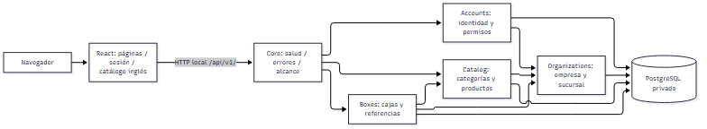
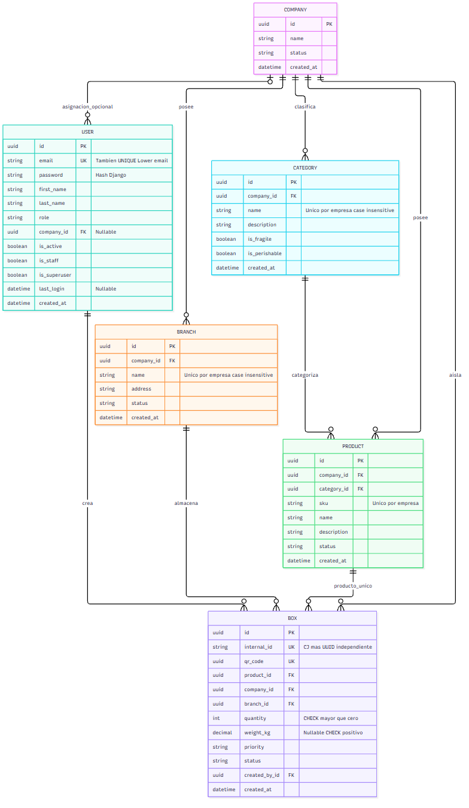
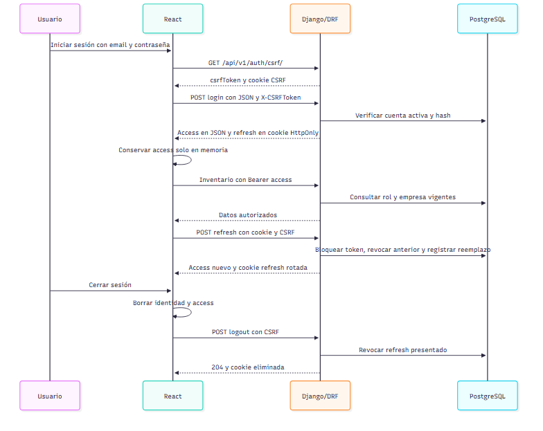
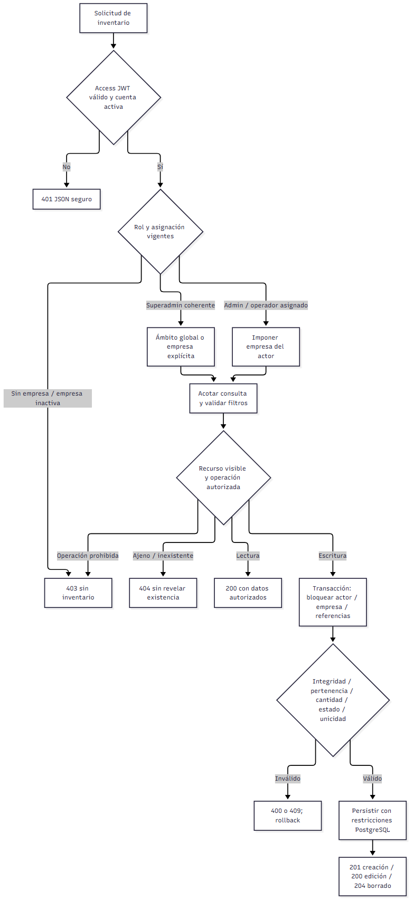

# LogisTech 2.0 — Informe académico del núcleo inicial

Fecha: 27 de octubre de 2026, America/Lima. Versión documental: entrega con anexo probatorio para presentación, posterior a la adaptación F5. Proyecto académico de Desarrollo de Soluciones en la Nube — TECSUP.

**Estado:** núcleo F0–F5 validado localmente; adaptación de idioma y consolidación documental en esta entrega. Requisito cloud **PARCIAL**, sin aplicación desplegada externamente. F6/F7/F8 no iniciadas. La publicación del código en GitHub no representa un despliegue del sistema.

## 1. Definición del proyecto y objetivos

### 1.1 Problema y propuesta

LogisTech 2.0 organiza la identificación y consulta de mercancía por empresa. La información de producto, categoría, cantidad, sucursal, prioridad e identificación necesita permanecer vinculada y accesible solo a las personas autorizadas. El núcleo implementado proporciona categorías y cajas, un identificador interno automático independiente del QR y un espacio de consulta operativo. No se presenta como sistema completo de gestión de almacenes ni como contabilidad de stock.

La aplicación web conserva la dirección visual Industrial Precision: alternativa A como composición principal con recursos oscuros de marca inspirados en B. React se conecta a una API Django/DRF y PostgreSQL real. El programa se presenta en inglés por defecto y la documentación permanece en español.

### 1.2 Objetivo general

Construir y validar un núcleo web multiempresa para registrar, clasificar y consultar cajas mediante autenticación y permisos en servidor, con integridad de datos, documentación reproducible y límites explícitos.

### 1.3 Objetivos específicos verificables

- Ofrecer registro y login separados; registro público de operador sin asignación de empresa o privilegios.
- Implementar CRUD de categorías y cajas, referencias legibles y búsquedas/filtros autorizados.
- Aislar consultas/escrituras por empresa y rechazar enlaces a recursos ajenos.
- Generar internal_id en servidor y mantener QR independiente, ambos únicos sin usarlos como autorización.
- Validar PostgreSQL, migraciones, seguridad, interfaz responsive, accesibilidad automática y rendimiento local con evidencia.
- Proporcionar instalación reproducible y documentación de arquitectura, datos, procesos y mantenimiento.
- Centralizar los textos de aplicación en inglés sin modificar contratos o datos introducidos por usuarios.

### 1.4 Usuarios y audiencia

SUPERADMIN administra el ámbito global conforme a flags coherentes; COMPANY_ADMIN trabaja en su empresa; OPERATOR asignado lee categorías y opera cajas autorizadas sin eliminarlas; operador sin empresa no accede a inventarios privados. El usuario operativo debe conocer su trabajo de almacén, sin necesidad de manipular UUID o configurar Django. El informe se dirige también al profesor y a quienes mantengan el sistema; la instalación presupone manejo básico de Git, terminal, variables de entorno y Docker.

### 1.5 Autoría y antecedentes

El repositorio de esta implementación es `anthonyarana-debug/logistech-2.0`, actualmente público, según consulta directa a GitHub durante la adaptación. La titularidad de una cuenta GitHub no acredita por sí sola integrantes o contribuciones académicas: esta documentación no inventa una nómina ni reparte porcentajes de autoría. El responsable debe completar la identificación académica exigida por su institución antes de presentar el informe.

Existe como antecedente un proyecto Android separado. No se modificó ni sobrescribió. No se realizó una auditoría de sus fuentes Android para acreditar reutilización o retrocompatibilidad; esta versión define su API propia y no garantiza compatibilidad con contratos Android no verificados. El nombre 2.0 expresa la evolución del proyecto, no una certificación de integración entre ambas aplicaciones.

## 2. Especificación de requisitos y alcance

### 2.1 Requisitos generales y funcionales

**Tabla 1**

*Requisitos funcionales del núcleo inicial*

| ID | Requisito | Implementación / evidencia |
|---|---|---|
| RF-01 | Registro e inicio de sesión separados | accounts, formularios públicos, pruebas auth/E2E |
| RF-02 | Identidad vigente y sesiones renovables | JWT access en memoria, refresh HttpOnly/CSRF/rotación/blacklist |
| RF-03 | Categorías con condiciones independientes | CRUD Category; fragilidad y perecibilidad pueden coexistir |
| RF-04 | Cajas con contexto y cantidades | Box enlaza producto/categoría/sucursal/empresa; quantity positiva |
| RF-05 | Identificación alternativa | internal_id CJ- automático y QR independiente; búsqueda exacta |
| RF-06 | Permisos y aislamiento | Backend consulta rol/empresa actuales, querysets acotados, FK coherentes |
| RF-07 | Consulta operativa | Dashboard de conteos actuales, listas, filtros, detalle y referencias |
| RF-08 | Estados y borrado controlados | REGISTERED permite operaciones iniciales; RECEIVED/REJECTED finales; categoría referenciada protegida |
| RF-09 | Errores y salud | JSON seguro; 200/201/204/400/401/403/404/405/409/429/500; readiness 503 |
| RF-10 | Inglés predeterminado | Catálogo propio frontend, mensajes/etiquetas backend y lang=en |

Trazabilidad del entregable académico original: [MATRIZ_ENTREGABLES](MATRIZ_ENTREGABLES.md) y [CHECKLIST_SEMANA_11](CHECKLIST_SEMANA_11.md). Correspondencia con la guía del profesor: [MATRIZ_GUIA_PROFESOR](MATRIZ_GUIA_PROFESOR.md).

### 2.2 Requisitos no funcionales

Seguridad: contraseñas con hash y validadores, mínimo privilegio, CSRF, cookies HttpOnly, errores sin SQL/tracebacks, secretos fuera de Git, PostgreSQL sin puerto público y límites de solicitudes. El rate limiting local por proceso no equivale a protección distribuida y atómica en producción.

Mantenibilidad: monolito modular, rutas `/api/v1/`, dependencias fijadas, migraciones versionadas, Custom User desde su primera migración y pruebas positivas/negativas. Accesibilidad/responsive: teclado, foco, Escape, movimiento reducido, anchos 320/390/768/1440 y axe en vistas probadas. No se declara certificación WCAG ni lector físico verificado.

Operación: Python/Django y Node en versiones fijadas, entornos aislados y Docker Linux. El rendimiento registrado es local y no representa capacidad cloud ni máximo del sistema. La documentación de instalación no transporta bases, volúmenes o contraseñas por Git.

### 2.3 Alcance y exclusiones

Se implementan identidad, categorías, cajas y referencias mínimas de empresas/sucursales/productos. No hay CRUD web completo de organizaciones, recepción avanzada, cámara/escaneo, OCR, movimientos, stock contable, historial de negocio ni reportes avanzados. La marca RECEIVED no constituye por sí sola un módulo completo de recepción. No se implementa un segundo tema visual ni un idioma español parcialmente disponible. F6/F7/F8 permanecen fuera de autorización.

Cloud: hay configuración y artefactos de producción preparados parcialmente, pero no dominio, TLS, PostgreSQL cloud, URL pública ni despliegue verificados. Se conserva esa limitación aun cuando el código fuente sea público.

## 3. Procedimientos de desarrollo, instalación y prueba

### 3.1 Desarrollo y herramientas

Se trabajó incrementalmente por fases autorizadas: F0 auditoría/plan; F1 infraestructura; F2 modelos/autenticación; F3 API/CRUD; F4 interfaz; F5 validación. Esta adaptación es un ajuste posterior de idioma/documentación, no una nueva fase funcional. No se atribuye una metodología Scrum formal, sprints o equipo que no estén acreditados.

Versiones fijadas del proyecto: Python 3.13.17, Django 5.2.18, DRF 3.16.1, SimpleJWT 5.5.1, psycopg 3.3.6, PostgreSQL 17.11, Node 24.19.0, React 19.3.1 y Vite 8.3.5. Git y Docker Compose permiten recuperar código y servicios locales; pytest/Node/Playwright/axe/Ruff/ESLint y Locust se usan según su propósito. Las versiones de pruebas se obtienen de los lockfiles, sin depender de paquetes globales.

### 3.2 Obtención e instalación

Guía completa: [NUEVA_COMPUTADORA](NUEVA_COMPUTADORA.md). Resumen Windows/PowerShell:

```powershell
git clone https://github.com/anthonyarana-debug/logistech-2.0.git
cd logistech-2.0
git config --local core.hooksPath .githooks
py -3.13 scripts/configurar_entorno.py
docker compose build
docker compose up -d --wait db
docker compose run --rm --no-deps backend python manage.py migrate --noinput
docker compose up -d --wait --wait-timeout 180
```

Docker Desktop debe mostrar motor Linux. El generador crea secretos aleatorios localmente y rechaza sobrescribir .env. La API/web de desarrollo solo se publican en loopback; PostgreSQL no publica 5432. Abrir `http://127.0.0.1:5173/`. El repositorio público permite clonar sin credenciales; escribir en GitHub requiere autorización/autenticación segura. La adaptación de esta entrega sigue local hasta revisión y no se obtiene todavía al clonar main remoto.

Los datos DEMO se crean expresamente en una base académica y su archivo privado se ignora en Git. Crear superadmin mediante prompt `createsuperuser`; no incluir credenciales fijas en documentación. `docker compose stop` conserva datos; no usar `down -v` como rutina.

### 3.3 Ejecución y pruebas reproducibles

La adaptación usa proyecto Compose aislado `logistech-language` con el override de validación: loopback 8001/5174, volumen propio y PostgreSQL real. No sustituye PostgreSQL por SQLite. El script `scripts/verify_adaptation.py` registra checks, migraciones, backend, lint, build y unitarias sin sobrescribir evidencias F0–F5. E2E requiere datos DEMO propios y reportes ignorados; resultados saneados en evidencias. Instrucciones concretas en [PRUEBAS](PRUEBAS.md).

## 4. Arquitectura y módulos

### 4.1 Organización y diagrama global

Monolito modular backend con frontend separado y una base relacional compartida. El aislamiento de negocio depende de permisos/consultas/transacciones, no de bases físicas distintas por empresa.

**Figura 1**

*Arquitectura modular de la implementación local*



*Nota.* Elaboración a partir de la arquitectura y procesos implementados; esquema documental, no ejecución nueva.

En producción se requerirían HTTPS, proxy autorizado, frontend compilado y servidor WSGI; el esquema describe el sistema implementado localmente, no infraestructura cloud activa.

### 4.2 Fichas de módulos

**Tabla 2**

*Módulos implementados y responsabilidades*

| Módulo / archivos | Propósito y responsabilidades | Dependencias y restricciones |
|---|---|---|
| core — backend/apps/core | Salud, errores seguros, filtros/CRUD base, referencias, mensajes/etiquetas y presentación Admin | Django/DRF/ORM; no autoriza por UUID conocido ni expone fallos de prueba |
| accounts — backend/apps/accounts | Usuario, gestores, registro/login/refresh/logout/identidad, permisos y throttles | Django auth, SimpleJWT, organizations; no autoasignación de empresa/rol público |
| organizations — backend/apps/organizations | Company, Branch, validación base y pertenencia | PostgreSQL/ORM; referencias mínimas, sin CRUD web completo |
| catalog — backend/apps/catalog | Category y Product; CRUD de categorías y condiciones | organizations y core; operador no administra categorías; referencias protegidas |
| boxes — backend/apps/boxes | Box, IDs, cantidad/peso, prioridades/estados, CRUD y bloqueo de referencias | accounts/catalog/organizations/core; estados finales protegidos, QR no es autorización |
| config — backend/config | Configuración por entorno, URL raíz, Admin restringido y arranque WSGI/ASGI | Variables fuera de Git; no habilita auth_user estándar ni DEBUG de producción |
| sesión/servicios — frontend/src/auth.jsx y services | Máquina de sesión, Fetch seguro, restauración/renovación y errores | API real; access solo en memoria; permisos finales siempre en backend |
| páginas/componentes — frontend/src/pages y components | Landing, formularios, dashboard, listas, detalle, estados comunes y responsive | React Router/servicios; no CRUD ficticios ni funciones futuras aparentes |
| i18n — frontend/src/i18n | Catálogo inglés, interpolaciones y formatos | Intl/React; no API externa, no traducción de datos del usuario |
| validación — backend/tests, frontend/unit/e2e, load, scripts | Pruebas y evidencias reproducibles | Entornos separados; no ejecutar carga o datos demo contra producción |

### 4.3 Dependencias y decisiones

Django aporta ORM, migraciones, autenticación y Admin; DRF organiza serializers/vistas/errores; SimpleJWT aporta tokens/rotación/blacklist; psycopg conecta PostgreSQL. React compone UI y estado; Router resuelve navegación; Fetch evita introducir un cliente HTTP adicional; Tailwind y CSS sostienen Industrial Precision. Docker aísla procesos/dependencias; PostgreSQL conserva unicidad, FKs y CHECK. GitHub aloja código, no la base ni los servicios de aplicación.

El monolito reduce coordinación operativa y permite transacciones para un entregable académico limitado. No se introducen microservicios, Kubernetes, colas o Redis solo para aparentar complejidad. Antes de producción multiproceso debe resolverse limitación compartida y atómica. Decisiones y alternativas: [DECISIONES_TECNICAS](DECISIONES_TECNICAS.md).

## 5. Modelo de datos

La Figura 2 presenta las seis entidades de negocio; la Tabla 3 resume sus atributos.

**Figura 2**

*Modelo relacional de las seis entidades de negocio*



*Nota.* Fuente editable MODELO_DATOS.mmd; renderizado verificado en F5. Omite tablas de framework documentadas en BASE_DE_DATOS.md.

Diseño relacional independiente del lenguaje: seis entidades de negocio. Diagrama ER editable [MODELO_DATOS.mmd](MODELO_DATOS.mmd); representación verificada en F5 [SVG](evidencias/fase5-modelo-datos.svg). Detalle y migraciones en [BASE_DE_DATOS](BASE_DE_DATOS.md). Las tablas del framework se documentan aparte y no se ocultan como si no existieran.

**Tabla 3**

*Entidades del modelo relacional implementado*

| Entidad | Atributos y relaciones principales |
|---|---|
| Company | UUID, nombre, estado y creación; agrupa sucursales/categorías/productos/cajas |
| Branch | UUID, empresa, nombre, dirección, estado y creación; nombre único por empresa |
| User | UUID, email único case-insensitive, hash, nombres, rol, empresa opcional, flags y fechas |
| Category | UUID, empresa, nombre único por empresa, descripción, flags frágil/perecedera y creación |
| Product | UUID, empresa, categoría, SKU único por empresa, nombre/descripción, estado y creación |
| Box | UUID, internal_id único, qr_code único independiente, empresa/producto/sucursal/creador, cantidad, peso opcional, prioridad, estado y creación |

User se creó en accounts/0001_initial y `AUTH_USER_MODEL=accounts.User` antecede a migrar auth/admin. No se reescriben migraciones por traducir. Hay CHECK de cantidades/peso y valores permitidos; PROTECT evita borrar referencias requeridas. Las FKs simples no garantizan por sí solas igualdad de empresa entre tablas: validación y transacciones del servidor imponen esa coherencia. SQL/bulk/update que omitan reglas de modelo no constituyen una vía autorizada de escritura de negocio.

**Tabla 4**

*Clasificación de datos de entrada internos y de salida*

| Tipo de dato | Ejemplos | Tratamiento / salida |
|---|---|---|
| Entrada | Email/password, nombre/descripción de categoría, UUID de producto/sucursal, cantidad/peso, filtros | Validación de formato, límites, pertenencia y permisos; no traducción de nombres de negocio |
| Interno | Hash, rol/asignación vigente, IDs generados, relaciones, refresh/blacklist, timestamps UTC | No exponer secretos; bloqueo/transacción e integridad PostgreSQL |
| Salida | Identidad acotada, registros autorizados, estados/enums, referencias, errores y health | JSON con contrato estable; inglés de presentación; sin password/refresh en JSON de identidad |

## 6. Procesos y servicios

### 6.1 Registro y sesión

El registro recibe email/password y nombres opcionales; verifica validadores y campos permitidos; crea únicamente OPERATOR sin empresa y devuelve 201, sin iniciar sesión automáticamente. El login valida credenciales con CSRF y límites; devuelve access en JSON y refresh HttpOnly. React conserva access en memoria. Refresh bloquea el token, revoca el anterior y emite reemplazo; logout borra identidad/cookie y revoca el refresh presentado. Un access emitido puede durar hasta cinco minutos tras logout. Flujo editable: [SESION.mmd](SESION.mmd); [SVG verificado](evidencias/adaptacion-sesion.svg).

**Figura 3**

*Secuencia de autenticación renovación y cierre de sesión*



*Nota.* Elaboración a partir de la arquitectura y procesos implementados; esquema documental, no ejecución nueva.

### 6.2 Autorización e inventario

Cada solicitud valida token/cuenta vigente, rol y empresa. Un operador sin empresa obtiene 403; los detalles de otra empresa devuelven 404 para no revelar existencia. Las consultas se acotan antes de buscar por ID/QR. Las escrituras bloquean actor, empresa y referencias; el JSON no puede imponer company/created_by salvo selección inicial de empresa por superadmin. La búsqueda no concede autorización por conocer el identificador. Diagrama editable: [PROCESOS.mmd](PROCESOS.mmd); [SVG verificado](evidencias/adaptacion-procesos.svg).

**Figura 4**

*Autorización y escritura del inventario por empresa*



*Nota.* Elaboración a partir de la arquitectura y procesos implementados; esquema documental, no ejecución nueva.

### 6.3 Categorías, cajas y borrado

Categoría: entrada nombre/descripción/condiciones; se impone empresa, valida unicidad y devuelve representación. Operador solo lectura; borrar una categoría referenciada produce conflicto. Caja: entrada producto/sucursal/cantidad/peso/prioridad; servidor impone IDs/creador y exige referencias coherentes y activas. Las transiciones iniciales a RECEIVED/REJECTED son finales dentro del alcance; no implementan eventos de recepción avanzada. Borrado de caja solo por rol autorizado y estado REGISTERED. Todas las operaciones fallidas mantienen errores seguros y coherencia transaccional.

## 7. API y manual técnico

Contrato público versionado en [ENDPOINTS](ENDPOINTS.md); firmas, argumentos, tipos, defaults, retorno y restricciones internas en [API_INTERNA](API_INTERNA.md). Invocación web: landing → registro/login → asignación pendiente o workspace → categorías/cajas según rol. Los formularios seleccionan nombres/SKU; no piden UUID manual al operador.

Rutas de autenticación: GET csrf, POST register/login/refresh/logout y GET me bajo `/api/v1/auth/`. Categorías y cajas: GET/POST en colección y GET/PUT/PATCH/DELETE en detalle UUID. Referencias: GET `/api/v1/references/`; salud: GET health y health/live. Bodies JSON, Bearer access para inventario y CSRF para mutaciones de sesión. Filtros, obligatoriedad y límites están detallados en ENDPOINTS, sin duplicar el contrato entero aquí.

Se conservan claves legadas como `detalle`, `errores`, `estado` y valores health `disponible`/`no_disponible`. Cambia el texto humano al inglés, no los nombres de campos, códigos HTTP, rutas o enums. Las pruebas cliente deben evaluar estructura/códigos, no depender de frases traducibles. Internacionalización: [INTERNACIONALIZACION](INTERNACIONALIZACION.md).

## 8. Resultados, incidencias y limitaciones

F5 registró 156 pruebas backend, cinco unitarias JS y nueve E2E finales. Su primera ejecución E2E tuvo tres fallos por cuota de refresh consumida, conservados y explicados; el entorno aislado posterior aprobó nueve casos con límites intactos. Son resultados históricos, no pruebas de despliegue ni mediciones repetidas durante esta adaptación.

Carga F5 local: 50 y 100 usuarios activos de API, aproximadamente 180 segundos de medición, 23.19/46.37 RPS, p95 22/38 ms y cero fallos HTTP. Una cuenta hizo login HTTP por escenario; las demás usaron JWT de fixtures legítimos. Hubo incidencia del exportador CSV Windows al cierre y se preservaron resultados/limitaciones. No son cien logins simultáneos o cien navegadores, ni medida de capacidad máxima. Informe: [REPORTE_RENDIMIENTO](REPORTE_RENDIMIENTO.md).

En la adaptación la base previa de 156 pruebas aprobó con PostgreSQL real. Las comprobaciones nuevas cubren inglés predeterminado, compatibilidad JSON/enums, datos españoles sin traducción, metadatos de modelo intactos, Admin y escapes, interpolaciones/formatos y navegador configurado en español. El cierre registra cifras y evidencias finales en [INFORME_ADAPTACION](INFORME_ADAPTACION.md); los resultados iniciales fallidos se conservan. No se sustituye evidencia por una afirmación de éxito.

No se ha desplegado infraestructura cloud ni verificado TLS/CA/base externa. La preparación Gunicorn local y readiness 503 por ausencia de TLS PostgreSQL local no acreditan cloud operativo. Permanecen limitación distribuida, despliegue autorizado y verificación externa; lector físico, zoom nativo y tacto físico siguen pendientes. No se afirma español opcional completo ni certificación WCAG. No se repite carga intensiva por un cambio de idioma sin motivo funcional.

## Anexo A Evidencias de pruebas

### A1 Alcance y criterio probatorio

Este anexo reúne resultados registrados del núcleo inicial y de la adaptación de idioma. No se repitieron pytest, Playwright ni las cargas Locust para preparar la presentación. Las capturas de interfaz ya existían; las nuevas capturas de Locust muestran los reportes HTML originales abiertos localmente, con la red bloqueada. No corresponden a una nueva ejecución de carga. Los extractos de consola se reproducen como texto literal y no se presentan como capturas de terminal.

Se utiliza APA 7 adaptado: tablas y figuras numeradas por separado, número en negrita, título en cursiva, notas de fuente e interpretación y referencias identificables. La maquetación técnica conserva tablas con rejilla tenue para lectura; no se declara cumplimiento de una plantilla institucional que no fue proporcionada. La identificación académica nominal sigue pendiente de confirmación del responsable.

**Tabla 5**

*Herramientas y pruebas con evidencia disponible*

| Herramienta | Objetivo | Resultado acreditado | Fuente |
|---|---|---|---|
| pytest | Validar backend, permisos, integridad y presentación inglesa | 163 aprobadas en 15.66 s | E01 |
| Playwright con Chromium | Verificar flujos web, roles, sesión e idioma | 10 aprobadas; 0 fallidas; 0 omitidas | E02 |
| axe dentro de Playwright | Revisar reglas WCAG A/AA en las vistas ejecutadas | Caso aprobado, sin infracciones detectadas por las reglas usadas | E02 y fuente accessibility.spec.js |
| Locust 2.47.0 | Medir API local con 50 y 100 usuarios | 4 161 y 8 368 solicitudes; 0 fallos HTTP | E03–E09 |
| Node test runner | Completar registro faltante de unitarias frontend | 8 aprobadas; ejecución local nueva de 0.315 s | E19 |
| Grafana k6 | Herramienta prevista en la semana 9 | Sin ejecución; no localizado en el entorno comprobado | E20 |

*Nota.* Las cifras pertenecen a pruebas de distinto alcance; no se suman en un único supuesto porcentaje de cobertura. La medición de carga corresponde a F5 y no acredita rendimiento de cada cambio posterior de idioma.

### A2 Pruebas backend con pytest

**Herramienta y objetivo.** pytest 9.1.1 con pytest-django 4.14.0 sobre Django 5.2.18. Se verifican autenticación y hashing, CSRF, permisos por rol, aislamiento entre dos empresas, campos protegidos, pertenencia de referencias, unicidad, cantidades/estados, códigos HTTP, errores seguros y presentación inglesa.

**Configuración y procedimiento.** La ejecución registrada utilizó Python 3.13.17 en el backend Docker, PostgreSQL real y configuración config.settings.testing. pytest creó su base de prueba a partir de las migraciones existentes y la eliminó al terminar; no utilizó SQLite ni el inventario de trabajo. Proyecto local aislado logistech-language. El comando interior registrado fue:

```text
python -m pytest --ds=config.settings.testing -q
-o cache_dir=/tmp/pytest-language-final
```

*Nota.* Las dos líneas anteriores forman un único comando; el prefijo completo de Docker Compose está conservado en E01.

**Evidencia literal recuperada de E01.**

```text
........................................................................ [ 44%]
........................................................................ [ 88%]
...................                                                      [100%]
163 passed in 15.66s
```

**Resultado e interpretación.** 163 pruebas aprobadas, código de proceso 0. Son 156 pruebas previas y siete pruebas nuevas de idioma/compatibilidad/Admin. El resultado respalda los casos automatizados ejecutados; no implica ausencia absoluta de defectos, cobertura total, auditoría externa o disponibilidad cloud. La primera regresión ampliada, con 162 aprobadas y un fallo de etiquetas OPTIONS, permanece en E10 junto con su explicación de corrección.

### A3 Flujos de navegador con Playwright

**Herramienta y objetivo.** Playwright 1.64.1 con Chromium. Se verifican pantallas públicas, registro/login, cuatro perfiles de acceso, CRUD, filtros, campos inválidos, estados finales, restauración/logout, renovación de sesión y predeterminado inglés incluso con navegador configurado en es-PE.

**Configuración y procedimiento.** Dos workers, cero retries, viewport inicial 1440 × 1000 y servicios de validación en loopback 5174/8001. Datos DEMO de namespace propio y PostgreSQL aislado. Las pruebas responsive usan anchos 320, 390, 768 y 1440. No se guardan trace, vídeo, storageState o credenciales en las evidencias compartidas. La ejecución completa duró 366.32 s; el caso de expiración esperó realmente el vencimiento del access, sin reducir su TTL de cinco minutos.

**Tabla 6**

*Casos recuperados del reporte Playwright*

| Caso | Resultado | Duración s |
|---|---|---|
| accesibilidad automática, ampliación CSS 200%, vacío, 403 y 500 | Aprobado | 7.09 |
| landing, responsive, teclado, movimiento reducido y rutas públicas | Aprobado | 2.60 |
| registro real y validación de confirmación; login incorrecto | Aprobado | 1.05 |
| administrador: CRUD, integridad, filtros, sesión y responsive operacional | Aprobado | 5.76 |
| operador asignado: lectura de categorías y caja autorizada | Aprobado | 1.11 |
| operador pendiente: sin consultas de inventario privado | Aprobado | 0.50 |
| superadmin: ámbito, referencias legibles y menú móvil | Aprobado | 56.51 |
| fallo de red simulado: error de servicio seguro y recuperable | Aprobado | 0.39 |
| English remains the default with Spanish browser preferences | Aprobado | 0.50 |
| access expira realmente a cinco minutos: renovación única y pérdida de refresh | Aprobado | 354.87 |

*Nota.* Fuente E02, diez casos, cero fallos y cero omisiones. Los tiempos de casos paralelos no se suman para obtener la duración total. La prueba de superadmin esperó una ventana de rate limiting; la cuota no fue reducida.

**Evidencia e interpretación.** Las Figuras 5 y 6 son capturas existentes de la ejecución adaptada, no maquetas. Se mantiene Industrial Precision y los datos de negocio españoles, mientras las etiquetas son inglesas. El caso de accesibilidad usa axe con reglas wcag2a, wcag2aa y wcag21aa y exige una lista vacía de infracciones. Esto no constituye certificación WCAG ni reemplaza lector de pantalla, tacto físico o zoom nativo. CSS zoom 200%, foco, teclado y Escape tienen verificación automatizada. Los fallos de red y errores 403/500 interceptados en navegador son simulaciones declaradas; los controles de backend se prueban también contra PostgreSQL real.

**Figura 5**

*Listado de cajas en inglés durante la ejecución Playwright*


*Nota.* Fuente E13, captura de la adaptación a 1440 px. Los nombres españoles de producto, sucursal y empresa son datos DEMO conservados. La imagen no acredita un despliegue cloud.

**Figura 6**

*Consulta de cajas en un viewport móvil de 390 píxeles*


*Nota.* Fuente E14, captura existente con viewport de navegador; no es una prueba en un dispositivo físico. El documento de la prueba verificó ausencia de desbordamiento horizontal general; las tablas pueden tener desplazamiento local.

### A4 Pruebas de carga con Locust

**Herramienta y objetivo.** Locust 2.47.0 y gevent 26.9.0, Python 3.13 aislado en .venv-load. Objetivo: observar latencia y volumen de solicitudes HTTP del inventario autorizado bajo dos cargas locales controladas, no medir logins masivos ni la capacidad máxima del sistema.

**Configuración.** Windows, AMD Ryzen 9 9950X, 16 núcleos/32 hilos; Docker Linux 29.5.3 con aproximadamente 7.33 GiB visibles. Backend Django runserver y PostgreSQL 17.11 privado, generador y servicios en el mismo equipo. Destino exclusivo http://127.0.0.1:8001 de logistech-f5. No se usaron servicios externos, Gunicorn cloud, HTTPS ni bases de producción.

**Tabla 7**

*Configuración efectiva de los escenarios Locust*

| Parámetro | Escenario A | Escenario B |
|---|---|---|
| Usuarios configurados y activos medidos | 50 / 50 | 100 / 100 |
| Incorporación de usuarios | 5 usuarios/s | 10 usuarios/s |
| Calentamiento | 30 s | 30 s |
| Medición efectiva | 179.45 s | 180.44 s |
| Espera entre tareas | Aleatoria de 1–3 s | Aleatoria de 1–3 s |
| Autenticación | 1 login HTTP; demás JWT de fixtures | 1 login HTTP; demás JWT de fixtures |
| Escritura máxima por usuario | 1 POST y 1 PATCH de caja | 1 POST y 1 PATCH de caja |

*Nota.* Fuentes E03 y E04. Todos los usuarios consultaron identidad autorizada y se mantuvieron los permisos, CSRF, cuotas, TTL y aislamiento. No son cincuenta o cien logins simultáneos ni pestañas de navegador.

**Procedimiento registrado.** Humo previo, escenario A y después B, sin otra suite intensa concurrente. Se usaron dos empresas DEMO y cuentas limitadas al namespace. Al segundo 30 se reiniciaron los contadores de medida, no las protecciones de autenticación. Las tareas consultan cajas, categorías e ID exacto y hacen escrituras acotadas. Al finalizar se retiraron las cuentas de carga y se conservaron registros DEMO para auditoría. Este procedimiento se describe para reproducibilidad; no se volvió a ejecutar durante la preparación del informe.

**Tabla 8**

*Resultados finales de carga local con 50 y 100 usuarios*

| Usuarios | Solicitudes | Media ms | p95 ms | Solicitudes/s | Fallos HTTP |
|---|---|---|---|---|---|
| 50 | 4 161 | 14.44 | 22 | 23.19 | 0 / 0.00% |
| 100 | 8 368 | 19.23 | 38 | 46.37 | 0 / 0.00% |

*Nota.* Fuentes E03–E05: eventos finales de cierre y CSV consolidado contrastados. p95 es el percentil 95 de latencia, no una latencia máxima. Las cifras se redondean a dos decimales donde procede; los valores originales conservan precisión completa.

**Interpretación.** En la mezcla y duración ejecutadas, el escenario B procesó aproximadamente el doble de solicitudes por segundo, con mayor latencia media y p95, sin fallos HTTP de capacidad. No se acreditó saturación ni máximo de usuarios. La cercanía entre generador y servicios limita la generalización: estas cifras no predicen latencia de Internet, desempeño en EC2/RDS, experiencia de navegador o producción multiproceso.

Las Figuras 7 a 10 son capturas actuales de los reportes HTML originales, abiertos sin acceso de red. Sus agregados coinciden con los eventos finales. Se omiten aquí las gráficas completas por espacio; el HTML íntegro y su hash están en el paquete de evidencias.

**Figura 7**

*Estadísticas de solicitudes del reporte Locust de 50 usuarios*


*Nota.* Captura del reporte original E06, no de una nueva carga. La fila Aggregated muestra 4 161 solicitudes, 0 fallos, 14.44 ms de media y 23.19 solicitudes/s. Las filas de login/CSRF con contador cero pertenecen a la fase de medición posterior al calentamiento y no significan que se haya desactivado autenticación.

**Figura 8**

*Percentiles del reporte Locust de 50 usuarios*


*Nota.* Captura de E06; la fila Aggregated muestra p95 de 22 ms.

**Figura 9**

*Estadísticas de solicitudes del reporte Locust de 100 usuarios*


*Nota.* Captura de E07; el agregado muestra 8 368 solicitudes, 0 fallos, 19.23 ms de media y 46.37 solicitudes/s.

**Figura 10**

*Percentiles del reporte Locust de 100 usuarios*


*Nota.* Captura de E07; el agregado muestra p95 de 38 ms. Los reportes HTML y datos fuente se conservaron sin sustituirlos por resultados recreados.

### A5 Incidencias y calidad de la evidencia

**Incidencia del exportador.** Al cerrar A y B, Locust en Windows registró ValueError: I/O operation on closed file en su escritor periódico CSV. Los eventos finales y los HTML registran 4 161/8 368 solicitudes y cero fallos HTTP; los snapshots CSV anteriores al cierre tienen 4 143/8 360, diferencias de 18 y ocho solicitudes. No se corrigieron manualmente los originales. El humo posterior del exportador corregido está en E18; sus 17 solicitudes y cero fallos no reemplazan los escenarios A/B.

**Evidencia literal de E08 y E09.**

```text
ValueError: I/O operation on closed file.
```

**Revisión de unitarias frontend.** El comando Docker guardado en E01 terminó con código 0 pero indicó tests 0; frontend/.dockerignore excluye unit. Por ello ese paso no acredita ocho pruebas. Se conservó E01 y se ejecutaron únicamente las ocho unitarias locales con Node 24.19.0, con mocks, sin iniciar servicios ni acceder a la base. E19 registra ocho aprobadas, cero fallos y 315.28 ms. La evidencia válida histórica de F5 contiene cinco unitarias; no se presenta como ocho de la adaptación.

**Tabla 9**

*Diferencias e incidencias preservadas en los registros*

| Registro | Observación real | Tratamiento documental |
|---|---|---|
| Regresión ampliada inicial | 162 aprobadas y 1 fallida en OPTIONS | Se conserva E10; regresión corregida de 163 en E01 |
| CSV periódico Locust A/B | 4 143 / 8 360 solicitudes | Snapshot, no total definitivo |
| Eventos finales y HTML A/B | 4 161 / 8 368, 0 fallos HTTP | Base de la Tabla 8 |
| Escritor CSV | Excepción al cierre | Se conserva consola; no se denomina generador libre de incidentes |
| Unitarias dentro de contenedor | Código 0, pero 0 pruebas | No se cuenta como aprobación de ocho |
| Recuperación de unitarias local | 8 aprobadas con mocks | Única suite nueva de esta preparación; E19 |

*Nota.* No hubo nuevas ejecuciones pytest, Playwright, Locust o k6 durante esta preparación documental. Una salida de proceso 0 no prueba por sí sola que se hayan descubierto y ejecutado casos.

### A6 Grafana k6 previsto y herramienta utilizada

Grafana k6 fue mencionado como herramienta prevista en la exposición de la semana 9, según el antecedente proporcionado por el responsable. La herramienta utilizada en las cargas documentadas fue Locust, acreditada por sus reportes originales. No se atribuyen a k6 las cifras de la Tabla 8.

La comprobación local E20 no encontró k6 en PATH, en las rutas estándar inspeccionadas o en las imágenes Docker locales. Los entornos LogisTech estaban detenidos. Para respetar la prioridad documental y la prohibición de modificar infraestructura, no se instaló k6, no se descargó una imagen, no se iniciaron servicios y no se ejecutó una carga adicional. No existen resultados o capturas de ejecución k6 en esta entrega. Esta comprobación no demuestra que el binario sea inexistente en cualquier otra ubicación no inspeccionada.

### A7 Trazabilidad de fuentes

**Tabla 10**

*Registro de fuentes primarias del anexo*

| ID | Archivo o conjunto | Qué acredita |
|---|---|---|
| E01 | adaptacion-verificacion.json | pytest 163, checks y límite del paso Node Docker |
| E02 | adaptacion-e2e.json | Diez casos Playwright y sus duraciones |
| E03–E04 | a-50 / b-100 _summary.json | Eventos finales de carga |
| E05 | resumen-escenarios.csv | Consolidado contrastado de métricas |
| E06–E07 | a-50 / b-100 .html | Reportes originales y capturas de estadísticas |
| E08–E09 | a-50 / b-100 _console.txt | Cierre y excepción del escritor CSV |
| E10–E11 | Regresiones iniciales conservadas | Fallos reales previos, separados de los finales |
| E12 | fase5-verificacion.json | Evidencia histórica de cinco unitarias frontend |
| E13–E15 | Capturas adaptacion-cajas | Interfaz, responsive y ampliación CSS |
| E16–E17 | a-50 / b-100 _stats.csv | Snapshots anteriores al cierre |
| E18 | smoke _stats_final.json.json | Humo del exportador corregido |
| E19 | unitarias-frontend-recuperacion.json | Ocho unitarias locales y versión Node |
| E20 | k6-disponibilidad.json | Comprobación sin carga k6 |

*Nota.* Rutas completas, tamaño y SHA-256 íntegro de cada fuente se incluyen en evidencias/presentacion/manifest-evidencias.json. El hash permite comprobar integridad, pero no equivale a certificación independiente del experimento. El paquete compartido no contiene .env, credenciales DEMO, tokens, bases o volúmenes.


## 9. Referencias y anexos

- Guía del profesor: «Guía para la documentación de proyectos de software», Organización de Computadoras, Universidad Nacional del Sur, 2017, cinco páginas; copia local facilitada. La guía pide conclusiones; exactamente cinco e inglés predeterminado son condiciones adicionales del usuario.
- [Matriz del profesor](MATRIZ_GUIA_PROFESOR.md), [matriz del entregable](MATRIZ_ENTREGABLES.md), [plan](PLAN.md), [arquitectura](ARQUITECTURA.md), [seguridad](SEGURIDAD.md) y [pruebas](PRUEBAS.md).
- Informes F0–F5 y sus evidencias se preservan como historia del desarrollo. [PUBLICACION_GITHUB](PUBLICACION_GITHUB.md) distingue la publicación privada inicial del estado público actual.
- Dependencias y licencias: lockfiles y `docs/licencias/`; las plantillas Admin adaptadas conservan el aviso y licencia Django BSD.


### Referencias del anexo en formato adaptado

American Psychological Association. (s. f.). *Tables and figures*. APA Style. https://apastyle.apa.org/style-grammar-guidelines/tables-figures

*Registro final de verificación de la adaptación de LogisTech 2.0*. (2026). [Archivo JSON interno]. docs/evidencias/adaptacion-verificacion.json.

*Resultados Playwright de la adaptación de LogisTech 2.0*. (2026). [Archivo JSON y capturas internas]. docs/evidencias/adaptacion-e2e.json.

*Resultados Locust de 50 y 100 usuarios de LogisTech 2.0*. (2026). [Reportes HTML, CSV, JSON y registros de consola]. docs/evidencias/carga-fase5/.

*Recuperación probatoria de unitarias frontend de LogisTech 2.0*. (2026). [Registro JSON de ejecución local con mocks]. docs/evidencias/presentacion/unitarias-frontend-recuperacion.json.

*Guía para la documentación de proyectos de software*. (2017). Organización de Computadoras, Universidad Nacional del Sur. [Material facilitado para la documentación].

## 10. Conclusiones

1. El núcleo implementado permite autenticar usuarios, clasificar mercancía y gestionar cajas con identificadores independientes dentro de un alcance inicial verificable; recepción avanzada, escaneo e historial permanecen fuera de F0–F5.
2. El aislamiento por empresa y las validaciones en servidor son necesarios aun con una interfaz que limita acciones: las pruebas positivas y negativas sobre PostgreSQL respaldan permisos, pertenencia e integridad sin atribuir a las FKs una protección que no proporcionan por sí solas.
3. La validación local dejó evidencia reproducible y también incidencias reales, como cuotas de refresh consumidas y el cierre del exportador de carga; conservarlas permite explicar las decisiones de aislamiento y corrección sin inventar aprobaciones.
4. Las métricas de carga F5 describen únicamente el entorno y los escenarios ejecutados; no justifican capacidad máxima, cien logins simultáneos ni disponibilidad cloud, cuyo requisito continúa parcial.
5. La centralización del inglés y la consolidación documental separan presentación, contratos y datos del usuario, mejorando el mantenimiento sin requerir una API externa, alterar migraciones o iniciar fases funcionales adicionales; el español completo permanece una ampliación opcional no habilitada.
