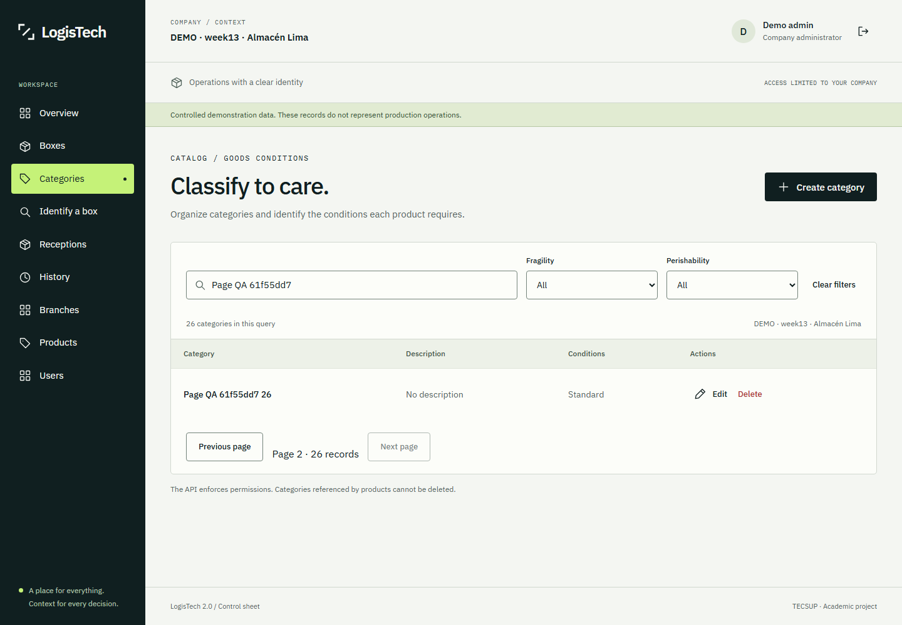
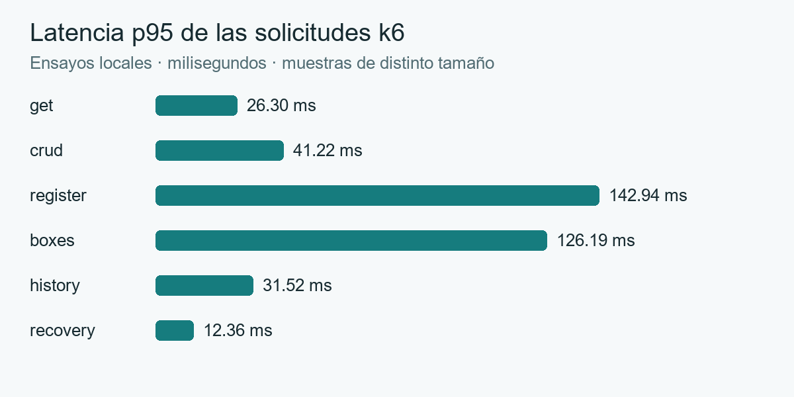

# LogisTech 2.0 Semana 13

## Introducción y objetivos

LogisTech 2.0 organiza el registro y la trazabilidad de cajas por empresa. Este informe documenta la paginación en servidor, la validación del ensayo de producción y la recuperación del sistema. El objetivo del 80 % se evaluó por requisito. El 100 % se abordó con instrumentación, carga acotada y preparación de operación.

## Estado anterior

El punto de partida fue el respaldo GitHub `9b840a0ac28df6e8d0f3530571aed0ee1b1ad046`, verificado contra la rama F7. Incluía F0–F6 Bloque 2 y los ensayos F7 de seguridad e infraestructura. Los informes anteriores conservan su fecha, alcance y resultados.

## Implementaciones y avances

Las colecciones de empresas, sucursales, usuarios, categorías, productos, cajas, recepciones e historial admiten paginación del servidor. La API devuelve count, next, previous y results al pedir page o page_size. El valor inicial es 25 registros, con máximo predeterminado de 100. Los clientes antiguos mantienen la respuesta en forma de lista.

El aislamiento por empresa y los filtros se aplican antes del conteo. El orden usa la fecha de creación y el identificador. Las tablas React muestran el total y navegación. Al cambiar el filtro vuelven a la primera página. El panel pide cinco cajas recientes y obtiene los totales por separado.

El CRUD conserva sus restricciones. El registro público crea un operador pendiente. Las recepciones y el historial conservan trazabilidad y no permiten borrado arbitrario. La autenticación usa correo, CSRF y JWT con renovación y cookies seguras en el ensayo.

## Capturas de funcionamiento

**Figura 1**

*Navegación real en una colección de 26 categorías sintéticas*

## Pruebas unitarias y de integración

| Suite | Resultado |
|---|---|
| Backend con PostgreSQL | 316 aprobadas, nueve de paginación |
| Frontend unitarias | 15 aprobadas |
| Playwright | Ocho regresiones y un caso de paginación aprobados |
| ESLint, Ruff y React build | Aprobados |
| Migraciones y HTTPS | Aplicación verificada, sin drift y respuesta HTTPS local |

Los casos API cubren total filtrado, permisos entre empresas, orden, compatibilidad con clientes previos y solicitudes inválidas. Playwright verificó login, roles, operaciones, QR, recepción, expiración y renovación. Django registró dos advertencias sobre alcance de HSTS y preload.

## Pruebas de carga y estrés

Se ejecutaron seis escenarios k6 en proyectos Docker independientes con sus propios datos y volúmenes. El perfil mayor completó 100 consultas GET autenticadas en 7.219 s, con 13.85 solicitudes por segundo y p95 de 26.30 ms. Las 122 solicitudes de los seis escenarios tuvieron respuestas 2xx. El escenario de registro hizo dos altas y ambas persistieron.

| Escenario | Iteraciones | Solicitudes | p95 ms |
|---|---:|---:|---:|
| GET paginado | 100 | 100 | 26.30 |
| CRUD | 2 | 8 | 41.22 |
| Registro | 2 | 4 | 142.94 |
| Cajas y QR | 2 | 6 | 126.19 |
| Historial | 2 | 2 | 31.52 |
| Salud | 2 | 2 | 12.36 |

**Figura 2**

*Latencia p95 por escenario*

Los escenarios difieren en operaciones y tamaño de muestra. Un VU ejecuta varias iteraciones. Un CRUD emite cuatro solicitudes por iteración. CPU y RAM se tomaron como muestras puntuales. Las corridas de 1000–5000 y 10000–50000 quedan pendientes de dimensionamiento. El ensayo histórico de 200 registros reportado por el usuario pertenece a otra computadora.

## Problemas y correcciones

| Problema | Corrección | Evidencia |
|---|---|---|
| Colecciones completas en React | Consultas paginadas y totales separados | API y navegación E2E |
| Cache de Ruff sin permisos | Lint con cache desactivado | Ruff aprobado |
| Redes Docker agotadas | Retiro de redes de los proyectos de carga, con volúmenes conservados | Perfiles de historial y salud terminados |
| Paquetes con parche disponible | Actualización de paquetes Debian y Alpine y de x/net de Caddy | Escaneo de imágenes de Semana 13 |

## Seguridad y operación cloud

React y la API comparten origen mediante Caddy. Una consulta con origen ajeno no recibió autorización CORS. PostgreSQL opera en una red interna, con TLS verificado y un rol de aplicación sin permisos de creación de roles ni bases. Gunicorn registra acceso estructurado y Docker limita CPU y memoria.

El escaneo de las imágenes finales verificó cero alertas CRITICAL y cero HIGH con versión corregida indicada. Quedan 48 HIGH residuales. PostgreSQL quedó sin alertas HIGH ni CRITICAL. Los identificadores de las imágenes y los informes Trivy se guardaron junto a las evidencias.

El ensayo se ejecutó en localhost:8453. La preparación AWS conserva el plan Lightsail de Ohio, IPv4 pública, 4 GB y US$24 mensuales de lista. La confirmación de elegibilidad y la ejecución requieren autorización de recursos y DNS. La revisión residual de seguridad se registra en los resultados de pruebas.

## Backups y recuperación

Con las imágenes actualizadas se produjo un backup de 90 497 bytes. El verificador confirmó el checksum y restauró los datos en una base nueva en 1.258 s. Los manifiestos de ocho modelos coincidieron y el destino existente fue rechazado. Tras reiniciar PostgreSQL y backend, la comprobación de datos volvió en 3.271 s. Estas mediciones corresponden al volumen sintético del ensayo.

## Manual de usuario

1. Levante el ensayo con scripts/start_week13.ps1 y abra localhost:8453 con la CA local confiada.
2. Genere las cuentas con create_demo y consulte sus credenciales en privado.
3. Inicie sesión como administrador para operar el catálogo. Filtre, avance y retroceda entre páginas. Use operador para mostrar las rutas autorizadas.
4. Registre una caja, consulte el QR, realice su recepción y abra el historial.
5. Ejecute el runner k6 y el verificador de recuperación. Abra la gráfica HTML y compare el conteo de solicitudes con las iteraciones.

## Conclusiones

1. La paginación de servidor conservó la compatibilidad de clientes y evitó cargar las colecciones completas en las tablas migradas.
2. Las pruebas verificaron filtrado, navegación y aislamiento por empresa en PostgreSQL real.
3. Los seis perfiles pequeños completaron 122 solicitudes, con dos registros persistidos y sin fallos observados.
4. El backup restaurado y el reinicio conservaron los datos de los ocho modelos comparados.
5. La validación local adelantó el 100 % en métricas y recuperación. El despliegue público y la carga mayor siguen pendientes.

## Observaciones

1. La guía separa 80 % y 100 % y no asigna de forma inequívoca un porcentaje a la semana 13.
2. La diferencia entre iteraciones y solicitudes afecta la interpretación de cada prueba.
3. Los percentiles de muestras pequeñas no representan la capacidad de producción.
4. La política de registro limita las altas por IP y debe permanecer activa durante la demostración.
5. La restauración medida sirve de referencia para el ensayo. Un RTO operativo requiere condiciones y datos representativos.

## Anexos

- Matriz de requisitos, pendientes y guía de demostración de Semana 13.
- Evidencias JSON, CSV, HTML y capturas auténticas en docs/evidencias/semana13.
- Diagrama editable de la base de datos en docs/MODELO_DATOS.mmd.
- Guías F7 de AWS, DNS, backup y rollback conservadas en docs.
