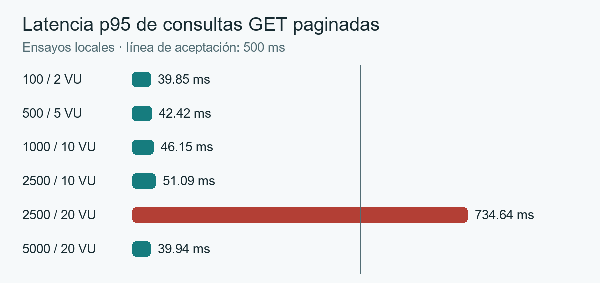

# LogisTech 2.0 Semana 13

## Introducción y objetivos

LogisTech 2.0 organiza el registro y la trazabilidad de cajas por empresa. Este informe documenta la paginación en servidor, la validación del ensayo de producción y la recuperación del sistema. El objetivo del 80 % se evaluó por requisito. El 100 % se abordó con instrumentación, carga acotada y preparación de operación.

## Estado anterior

El ZIP previo coincidió con el commit local `3dc19ffbcbe89d5ee211c6f4428b0423af5e2b06`. Su antecedente fue el respaldo GitHub `9b840a0ac28df6e8d0f3530571aed0ee1b1ad046`, verificado contra la rama F7. Incluía F0–F6 Bloque 2 y los ensayos F7 de seguridad e infraestructura. Los informes anteriores conservan su fecha, alcance y resultados.

## Implementaciones y avances

Las colecciones de empresas, sucursales, usuarios, categorías, productos, cajas, recepciones e historial admiten paginación del servidor. La API devuelve count, next, previous y results al pedir page o page_size. El valor inicial es 25 registros, con máximo predeterminado de 100. Los clientes antiguos mantienen la respuesta en forma de lista.

El aislamiento por empresa y los filtros se aplican antes del conteo. El orden usa la fecha de creación y el identificador. Las tablas React muestran el total y navegación. Al cambiar el filtro vuelven a la primera página. El panel pide cinco cajas recientes y obtiene los totales por separado.

El CRUD conserva sus restricciones. El registro público crea un operador pendiente. Las recepciones y el historial conservan trazabilidad y no permiten borrado arbitrario. La autenticación usa correo, CSRF y JWT con renovación y cookies seguras en el ensayo.

## Capturas de funcionamiento

**Figura 1**

*Navegación real en una colección de 26 categorías sintéticas*

## Pruebas unitarias y de integración

**Tabla 1**

*Verificaciones funcionales y técnicas*

| Suite | Resultado |
|---|---|
| Backend con PostgreSQL | 316 aprobadas, nueve de paginación |
| Frontend unitarias | 15 aprobadas |
| Playwright | 9 regresiones y paginación aprobadas, más 3 escenarios de resiliencia |
| ESLint, Ruff y React build | Aprobados |
| Migraciones y HTTPS | Aplicación verificada, sin drift y respuesta HTTPS local |

Los casos API cubren total filtrado, permisos entre empresas, orden, compatibilidad con clientes previos y solicitudes inválidas. Playwright verificó login, roles, operaciones, QR, recepción, expiración y renovación. Django registró dos advertencias sobre alcance de HSTS y preload.

## Pruebas de carga y estrés

Se probaron consultas GET autenticadas a la página 400 de un catálogo sintético de 10.000 categorías, sobre PostgreSQL y HTTPS locales. Cada usuario virtual (VU) usó su propia cuenta y respetó los límites de la API. Se exigió completar el volumen previsto, cero errores HTTP y p95 inferior a 500 ms.

**Tabla 2**

*Resultados de consultas paginadas con k6*

| GET | VU | Req/s | Media ms | p95 ms | Errores | Estado |
|---:|---:|---:|---:|---:|---:|---|
| 100 | 2 | 3.17 | 30.36 | 39.85 | 0 % | Pasó |
| 500 | 5 | 7.94 | 28.06 | 42.42 | 0 % | Pasó |
| 1000 | 10 | 15.83 | 29.21 | 46.15 | 0 % | Pasó |
| 2500 | 10 | 15.65 | 36.95 | 51.09 | 0 % | Pasó |
| 2500 | 20 | 26.18 | 144.55 | 734.64 | 0 % | Superó p95 |
| 5000 | 20 | 20.01 | 27.42 | 39.94 | 0 % | Pasó |

**Figura 2**

*Latencia p95 medida para cada perfil completo*

La corrida con 20 VU para 2.500 iteraciones superó el umbral. Con 10 VU, el mismo volumen pasó. Una repetición intermedia se abortó al corregir la lectura del estado del proxy. El perfil de registro de dos iteraciones produjo cuatro peticiones y dos altas persistidas. Los resultados de 200 registros comunicados por el usuario corresponden a otra computadora.

## Problemas y correcciones

**Tabla 3**

*Incidencias corregidas durante el ensayo*

| Problema | Corrección | Evidencia |
|---|---|---|
| Colecciones completas en React | Consultas paginadas y totales separados | API y navegación E2E |
| Cache de Ruff sin permisos | Lint con cache desactivado | Ruff aprobado |
| Redes Docker agotadas | Retiro de redes de los proyectos de carga, con volúmenes conservados | Perfiles de historial y salud terminados |
| Paquetes con parche disponible | Actualización de paquetes Debian y Alpine y de x/net de Caddy | Escaneo de imágenes de Semana 13 |

El fallo de PostgreSQL produjo 503 y el de Gunicorn produjo 502. Ambos volvieron a 200. El rollback a las imágenes F7 y el retorno a Semana 13 conservaron el total de seis categorías. Se verificó que la interfaz recuperara la tabla tras fallos simulados de red, 500 y 503.

## Seguridad y operación cloud

React y la API comparten origen mediante Caddy. Una consulta con origen ajeno no recibió autorización CORS. PostgreSQL opera en una red interna, con TLS verificado y un rol de aplicación sin permisos de creación de roles ni bases. Gunicorn registra acceso estructurado y Docker limita CPU y memoria.

El escaneo de las imágenes finales verificó cero alertas CRITICAL y cero HIGH con versión corregida indicada. Quedan 48 HIGH residuales, 47 en backend y una en el proxy. PostgreSQL quedó sin alertas HIGH ni CRITICAL. Los identificadores de las imágenes y los informes Trivy se guardaron junto a las evidencias.

El ensayo se ejecutó en localhost:8453. La preparación AWS conserva el plan Lightsail de Ohio, IPv4 pública, 4 GB y US$24 mensuales de lista. La confirmación de elegibilidad y la ejecución requieren autorización de recursos y DNS. La revisión residual de seguridad se registra en los resultados de pruebas.

## Backups y recuperación

El backup sintético ocupó 93.836 bytes y se generó en 6,994 s. Se verificó su checksum. La restauración en una base nueva tomó 6,429 s, conservó el manifiesto de ocho modelos y rechazó un destino existente. Tras reiniciar PostgreSQL y Gunicorn, el manifiesto se verificó a los 19,855 s. La prueba de cifrado autenticado AES-256-GCM recuperó el hash del archivo original y rechazó una copia alterada.

## Manual de usuario

1. Levante el ensayo con scripts/start_week13.ps1 y abra localhost:8453 con la CA local confiada.
2. Genere las cuentas con create_demo y consulte sus credenciales en privado.
3. Inicie sesión como administrador para operar el catálogo. Filtre, avance y retroceda entre páginas. Use operador para mostrar las rutas autorizadas.
4. Registre una caja, consulte el QR, realice su recepción y abra el historial.
5. Ejecute el runner k6 y el verificador de recuperación. Abra la gráfica HTML y compare el conteo de solicitudes con las iteraciones.

## Conclusiones

1. La paginación de servidor conservó la compatibilidad de clientes y evitó cargar las colecciones completas en las tablas migradas.
2. Las pruebas verificaron filtrado, navegación y aislamiento por empresa en PostgreSQL real.
3. El perfil de 5.000 consultas respetó el umbral y la corrida de 2.500 con 20 VU mostró sensibilidad a la concurrencia.
4. El backup restaurado y el reinicio conservaron los datos de los ocho modelos comparados.
5. Las mediciones y la recuperación aportan evidencia para el hito del 100 %. Quedan por ejecutar el despliegue público y los perfiles de 10.000 a 50.000.

## Observaciones

1. La guía separa 80 % y 100 % y no asigna de forma inequívoca un porcentaje a la semana 13.
2. La diferencia entre iteraciones y solicitudes afecta la interpretación de cada prueba.
3. Los percentiles de muestras pequeñas no representan la capacidad de producción.
4. La política de registro limita las altas por IP y debe permanecer activa durante la demostración.
5. La restauración medida sirve de referencia para el ensayo. Un RTO operativo requiere condiciones y datos representativos.

## Anexos

- Matriz de requisitos, pendientes y guía de demostración de Semana 13.
- Evidencias JSON, CSV, HTML y capturas auténticas en docs/evidencias/semana13-cierre. La carpeta previa conserva los resultados históricos.
- Diagrama editable de la base de datos en docs/MODELO_DATOS.mmd.
- Guías F7 de AWS, DNS, backup y rollback conservadas en docs.
